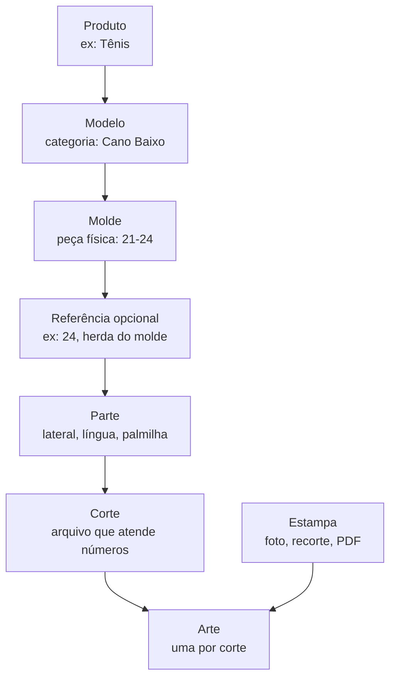
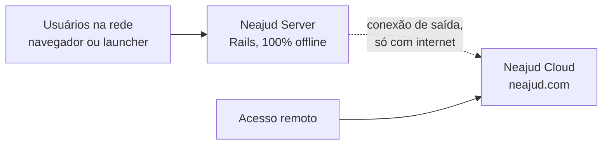

# Neajud — Instruções de Implementação

Atualizado em 26/09/2026

## Contexto e visão

O Neajud evolui de um app Rails interno para um produto vendido como serviço: uma assinatura na nuvem que funciona completa sem instalar nada, com um servidor local opcional para trabalhar sem internet. Este documento orienta o agente de código, fase por fase.

**Para quem:** pequenas produções (gráficas, ateliês, sublimação, frequência, private label) com 4 a 10 usuários.

**A rede:** empresas diferentes trabalham sobre o mesmo catálogo de modelos. Uma sublimação e uma empresa de frequência usam a mesma base de calçado, e cada uma acrescenta sua própria camada. O catálogo compartilhado é o diferencial do produto.

**Princípios que valem para todas as fases:**

- Com servidor local, o trabalho do dia a dia nunca depende da internet.
- No plano local, os dados da empresa ficam no servidor local; a nuvem guarda identidades, licenças e o catálogo compartilhado.
- Nada é apagado fisicamente: exclusões são lógicas e reversíveis.
- Versões publicadas são imutáveis; mudanças geram novas versões e alertas, nunca substituições silenciosas.
- O que é cobrado (nuvem, atualizações) é controlado nos servidores do Neajud, não na máquina do cliente.

## Glossário e modelo de domínio

O domínio tem duas camadas: o catálogo compartilhado entre empresas e a camada privada de cada empresa e seus clientes. Tamanhos existem sempre número a número; o agrupamento acontece nos cortes.

De Produto a Corte é catálogo; Estampa e Arte são privadas da empresa e do cliente. Exemplo real: Tênis › Cano Baixo › molde 21-24 › referências 21 e 24 › Lateral, Língua, Palmilha.

| Termo | No código hoje | Definição |
| --- | --- | --- |
| Produto | não existe | Categoria ampla: tênis, chinelo, camisa, moletom, boné |
| Modelo | não existe; criar | Categoria de estilo: Flip Flop, Slide, Jogging, Cano Baixo, Cano Alto |
| Molde | `Molde` | Peça física, única ou variação de outro molde (ex: Slin e Unisex; 21-24; NB) |
| Referência | `Modelo` (renomear para `Referencia`) | Variação comercial sobre um molde, opcional; herda as partes e pode substituir, acrescentar ou remover |
| Parte | `Peca` | Pedaço do produto: lateral, língua, correia, cabedal, knit |
| Tamanho | `Tamanho` | Unidade individual da grade do produto: 33, 34, 35... ou P, M, G, GG |
| Corte | parte de `Molde` (DXF) | Arquivo de uma parte que atende um conjunto de tamanhos, com rótulo opcional (33-34, P) |
| Estampa | não existe | Material de origem do cliente: foto, recorte, arquivo, PDF de instruções |
| Arte | `Arquivo` | Arquivo de produção derivado da estampa; uma por corte |
| Processo | não existe | Tipo de trabalho da empresa: sublimação, frequência, bordado, silk |

**Regras do domínio:**

- Mudou a geometria do corte: é um novo molde, possivelmente variação de outro. Mesma geometria com identidade comercial diferente: é uma nova referência.
- Tamanhos são sempre individuais. O agrupamento (pares como 33-34, ou rótulos como P, M, G) é definido nos cortes: ao subir um corte, marca-se quais tamanhos ele atende.
- O molde define o agrupamento padrão; a referência herda ou substitui os cortes para agrupar de outro jeito (ex: cliente que trabalha número a número).
- Na publicação, os cortes de cada parte precisam cobrir todos os tamanhos da grade, sem buracos nem sobreposição.
- O pedido entra sempre por tamanho individual; a produção encontra o corte que atende aquele tamanho e, dele, a arte.
- "Contínuo" (impressão corrida, por metro) é um tipo especial de parte, sem tamanho nem corte.
- A Arte tem um arquivo de origem (PSD, CDR, AI, PNG, TIFF, JPG) e saídas de produção (TIFF em ultra resolução e JPG compactado para bitmaps, PDF para vetores).
- Cada empresa acrescenta sua camada de processo sobre as partes do catálogo, referenciando a parte pelo UUID.

**Estampa ⇄ Arte (em definição):** as duas se correlacionam, mas podem funcionar juntas ou separadas. Uma arte pode existir sem estampa, e uma estampa sem artes. A ligação entre elas é opcional e o formato final ainda será decidido.

## Arquitetura alvo

A nuvem é o produto principal: qualquer cliente que assina usa o Neajud completo, sem instalar servidor. O servidor local é uma facilidade opcional para trabalhar offline, e o launcher facilita o acesso.

| Componente | Repositório | Responsabilidade |
| --- | --- | --- |
| Neajud Server | `neajud` | Opcional, para trabalhar sem internet: roda num PC dedicado e atende a rede local |
| Neajud Cloud | `neajud-cloud` (novo, Rails separado) | Produto principal: hospeda o Neajud completo para quem assina, sem instalar nada. Também cuida de contas, perfis, licenças, pareamento, catálogo compartilhado, atualizações e acesso remoto aos servidores locais |
| Launcher | `neajud-launcher` (novo, Tauri) | Login, acesso à nuvem e aos servidores locais da conta, descoberta na rede via mDNS |

**Regras de arquitetura:**

- O servidor sempre inicia a conexão com a nuvem; nunca abre portas no roteador do cliente.
- A stack do servidor não muda: Rails 8, Hotwire, Stimulus, Importmap, SQLite, Solid Queue, Solid Cache, Solid Cable.
- Para quem tem servidor local, a nuvem não guarda cópia dos dados da empresa; o acesso remoto passa por um túnel até ele.
- A API entre servidor e nuvem é versionada (`/api/v1`) e aceita servidores de versões anteriores durante o prazo de adiamento de atualização.

**Dois planos, lançados em sequência (hospedado primeiro; local depois, junto com o launcher):**

- **Hospedado:** o cliente assina e usa em `neajud.com`, sem servidor próprio. Roda um Neajud Server por cliente na infraestrutura do Neajud.
- **Local:** opcional, para quem precisa trabalhar sem internet: o cliente instala a ISO num PC dedicado.

Os dois rodam o mesmo código e o mesmo formato de backup; migrar um cliente de um plano para o outro é restaurar um backup.

## Usuários e permissões

A conta é da pessoa; o acesso a cada empresa é um vínculo com um ou mais perfis fixos.

**Pessoa, empresa e vínculo:**

- A conta é única, na Neajud Cloud, e pertence à pessoa.
- Um vínculo liga a pessoa a uma empresa com um ou mais perfis. A mesma pessoa pode ser designer numa empresa, cliente de outra e dona da própria.
- Qualquer pessoa pode criar uma empresa, que começa no teste grátis.
- O login acontece na nuvem; a pessoa escolhe a empresa e é enviada à instância dela já autenticada. O servidor local mantém cópia dos vínculos da sua empresa para login offline.

**Dono e admin:**

- **Dono:** responsável pela conta. Cuida de plano, pagamento e licença; transfere a posse ou encerra a empresa; libera o acesso do suporte e é notificado dele; restaura excluídos; nomeia e remove admins. Toda empresa tem pelo menos um dono, e pode ter mais de um. Nenhum admin remove ou bloqueia um dono.
- **Admin:** administra o dia a dia: usuários, perfis, configurações, catálogo e aprovação de atualizações. Não mexe em cobrança, não encerra a empresa, não restaura excluídos.
- Se a empresa ficar sem dono acessível, a recuperação é feita pelo suporte, com verificação de identidade.

**Atualizado em 27/09/2026 — funções editáveis pelo dono.** Os perfis fixos abaixo viraram o **ponto de partida** de uma política que o dono edita na tela Funções: uma grade área × função com os níveis — / Ver / Editar / Excluir (cada nível inclui os anteriores), mais ações especiais. O dono também cria funções novas (no chão de fábrica, vários funcionários usam a mesma função). Cada pessoa tem **uma função**, e pode receber **acessos extras** que só aumentam o que a função dá. A Lixeira entrou como área (— / Ver / Restaurar), liberada pelo dono a quem ele quiser. O dono tem tudo e sua função não é editável; editar funções é só do dono. Evolução prevista: agrupar funções por **setor**. Motor próprio (sem Oso, cuja política fica num serviço externo, nem Action Policy, cujas regras ficam em código); se as regras por registro crescerem (cliente final), o motor pode mudar por baixo da classe `Autorizacao`.

**Perfis fixos, combináveis no mesmo vínculo** (as permissões somam; empresa de uma pessoa só tem o dono com tudo) — a grade inicial das funções:

| Ação | Dono | Admin | Atendimento | Designer | Produção | Cliente final |
| --- | --- | --- | --- | --- | --- | --- |
| Criar e editar pedidos | ✓ | ✓ | ✓ |  |  |  |
| Ver pedidos | ✓ | ✓ | ✓ | ✓ | ✓ | só os seus |
| Cadastrar clientes | ✓ | ✓ | ✓ |  |  |  |
| Criar estampas e artes | ✓ | ✓ | ✓ | ✓ |  | envia material |
| Catálogo (moldes, partes, cortes) | ✓ | ✓ |  | ✓ |  |  |
| Baixar saídas de produção | ✓ | ✓ |  | ✓ | ✓ |  |
| Atualizar status da produção | ✓ | ✓ |  |  | ✓ |  |
| Aprovar arte | ✓ | ✓ | ✓ | ✓ |  | ✓ |
| Compartilhar com outras empresas | ✓ | ✓ | ✓ | ✓ |  |  |
| Gerenciar usuários | ✓ | ✓ |  |  |  |  |
| Cobrança e plano | ✓ |  |  |  |  |  |
| Restaurar excluídos | ✓ |  |  |  |  |  |

O perfil Financeiro ainda não foi definido.

**Cliente final:** vínculo do tipo cliente. Vê apenas os próprios pedidos, estampas e artes; envia material e aprova artes. Pode criar a própria empresa a partir da conta, entrando no teste grátis.

**Aprovação de arte:** é um registro formal e não bloqueia a produção. Guarda quem aprovou, quando e qual versão, distinguindo dois casos:

- "Aprovada pelo cliente no sistema", quando o próprio cliente aprova;
- "Aprovação registrada por [nome], cliente aprovou por [canal]", quando a equipe registra, com o canal informado e anexo opcional.

O pedido mostra o estado de cada arte: aprovada, aguardando aprovação ou produzida sem aprovação.

**Suporte do Neajud:** acima de todas as empresas, via painel de suporte e impersonação (Etapa 7.2). O acesso está declarado nos termos de uso, fica registrado e o dono é notificado.

## Regras para o agente

O AGENTS.md do repositório continua valendo; estas regras se somam a ele.

**Processo:**

1. Uma fase por vez, e dentro dela uma etapa por PR. Features grandes viram séries encadeadas (1/N, 2/N), como já é feito.
2. Antes de mudar código: localizar o existente, entender, reutilizar. Ao terminar: rodar `bin/rspec`, `bash bin/e2e`, RuboCop, Brakeman e `bin/check-residues`.
3. Ao fim de cada etapa: listar arquivos alterados, explicar o que mudou, informar os testes executados e os problemas encontrados, e aguardar validação humana. O merge é sempre humano.
4. Commits no padrão Conventional Commits (`feat:`, `fix:`, `refactor:`, `test:`, `docs:`), porque as notas de versão serão geradas a partir deles.
5. Toda migração que transforma dados roda sobre uma cópia (`bin/dev-backup`) e tem rollback testado.

**Não fazer:**

- Não reescrever a aplicação nem trocar o frontend (sem React, Vue ou similares).
- Não usar `default_scope` para esconder registros excluídos.
- Não apagar registros fisicamente, exceto na anonimização de dados pessoais.
- Não processar PSD, TIFF, AI, EPS ou PDF dentro do request web.
- Não adicionar dependências sem justificar no PR.
- Não criar abstrações antes de existir um segundo uso real.

## Ordem de execução

A nuvem é lançada primeiro; o servidor local sai depois, junto com o launcher (Tauri). As fases estão numeradas na ordem em que devem ser feitas.

| Fase | O quê | Por quê nesta posição |
| --- | --- | --- |
| 0 | Fundações | Caro mudar depois que houver dados de clientes reais |
| 1 | Modelo de domínio | Idem: renomear, UUID e tamanhos individuais antes dos dados reais |
| 2 | Operação na nuvem | O produto principal é o plano hospedado |
| 3 | Pronto para o beta | O que o chão de fábrica precisa no primeiro dia |
| 4 | Lançamento beta | 2 ou 3 clientes, começando pela sublimação |
| 5 | Catálogo versionado com herança | Acrescentado sem migração destrutiva sobre as colunas da Fase 1 |
| 6 | Estampas e Artes | Depois do beta |
| 7 | Nuvem: contas, cobrança e suporte | Quando houver mais clientes |
| 8 | Servidor local e launcher | Lançados juntos, depois da nuvem |
| 9 | Compartilhamento entre empresas | Depende do catálogo versionado e da nuvem |

Regra de prioridade: fazer agora tudo que é caro mudar depois que houver dados de clientes reais; adiar o que pode ser acrescentado sem migração.

## Fase 0 — Fundações

Antes de qualquer recurso novo, corrigir o que conflita com as decisões deste documento.

**Etapa 0.1 — Higiene do repositório.** Tornar o repositório privado (feito em 26/09/2026), atualizar o README com o domínio real do sistema (feito no PR #98) e adicionar `test-results/` ao `.gitignore` (feito em 26/09/2026). Etapa concluída.

**Etapa 0.2 — Auditoria.** Sem alterar código, produzir `docs/current-state.md` com: models, controllers, services, jobs, rotas, autenticação, uso de UUID por entidade, exclusões físicas existentes e onde o processamento de arquivos roda. Marcar o que é específico de sublimação e o que é estrutura genérica do catálogo. Concluída em 26/09/2026: `docs/current-state.md`.

**Etapa 0.3 — Processamento em fila.** O upload hoje roda o `ArquivoProcessingJob` inline no POST. Passar para Solid Queue, com a interface mostrando o estado (na fila, processando, pronto, erro) via Turbo Streams. Ajustar os specs E2E para esperar o estado final. Concluída em 26/09/2026 (upload, nova versão e "Enviar arquivo"; em desenvolvimento e no E2E a fila e o cable rodam como na produção: Solid Queue no Puma e Solid Cable).

**Etapa 0.4 — Exclusão lógica.** Substituir exclusões físicas — hoje todas as rotas DELETE apagam de verdade: arquivos (incluindo o destroy em lote), clientes, modelos, moldes, peças, pedidos e a remoção de item de pedido — por:

- colunas `deleted_at`, `deleted_by_id`, `restored_at`, `restored_by_id`;
- escopos explícitos (a gem `discard` ou equivalente), sem `default_scope`;
- registro excluído continua visível onde já foi usado (pedidos, relatórios), com o selo "excluído em";
- validação no model que impede associar registro excluído a registros novos;
- restauração permitida só ao dono da empresa.

Concluída em 26/09/2026. Decisões desta etapa:

- **Onde entra:** arquivos (inclusive o lote), clientes, modelos, moldes, peças e pedidos vão para a lixeira (`/lixeira`), que lista tudo com o botão Restaurar. Remover um item ou zerar uma grade de um pedido em **rascunho** continua físico: é edição em andamento, e o pedido inteiro é que vai para a lixeira.
- **Sem cascata:** excluir um cliente, modelo ou molde não mexe no que depende dele (antes, excluir um cliente apagava os modelos e o estoque dele). Os dependentes continuam e mostram o selo.
- **Nome repetido:** cadastrar um nome que está na lixeira é recusado com um aviso para restaurar, para não haver dois registros iguais depois da restauração.
- **Quem:** até a Etapa 0.5, quem excluiu ou restaurou fica registrado pelo IP em `exclusao_logs`; `deleted_by_id` e `restored_by_id` já existem e ficam vazios até haver usuários. Até lá qualquer pessoa restaura; a 0.5 restringe ao dono.
- **Arquivos em disco:** ficam, para que pedidos e restaurações continuem com as prévias. Apagar de vez (esvaziar a lixeira) fica para quando houver necessidade.
- **Pedido em rascunho** que usa uma arte ou um corte na lixeira não pode ser confirmado (nova pendência "está na lixeira"). Um pedido na lixeira continua abrindo, mas fica congelado até ser restaurado.
- Escopos próprios (`Excluivel`: `ativos`/`excluidos`, `excluir!`/`restaurar!`) em vez da gem `discard`, sem dependência nova; nenhum `default_scope`.

**Etapa 0.5 — Autenticação e perfis.** Se não existir, implementar login local (gerador de autenticação do Rails 8, com `bcrypt`) e perfis: os perfis fixos da seção Usuários e permissões, combináveis no mesmo vínculo. Modelar desde já pessoa e vínculo (pessoa × empresa × perfis) e o registro de aprovação de arte, prevendo a ligação com a conta na nuvem (`cloud_user_uuid` opcional).

Dividida em quatro PRs (decidido em 27/09/2026; eram três, a política editável dividiu o antigo 2/3):

- **1/3 — Login e modelo de acesso** (concluída em 27/09/2026): login por e-mail e senha; `User` (a "pessoa" do plano; o nome em inglês foi escolhido para seguir o gerador do Rails), `Empresa` (uma por instância) e `Vinculo` com perfis; primeiro acesso por uma tela de configuração que cria a empresa e o primeiro dono e depois se fecha; os registros de autoria passam a guardar o usuário (além do IP). Sem recuperação de senha por e-mail: dono ou admin redefine (2/3); o e-mail vem com a conta na nuvem (Etapa 7.1).
- **2/4 — Política** (concluída em 27/09/2026): funções editáveis pelo dono (grade de níveis por área + ações especiais, criar e excluir funções), aplicadas no servidor (403) e na tela (menus e botões). As funções padrão (Dono, Admin, Atendimento, Designer, Produção) seguem a tabela acima.
- **3/4 — Usuários:** tela de usuários com função, acessos extras, senha provisória (troca no próximo login) e desativação.
- **4/4 — Aprovação de arte:** o registro formal e o estado de cada arte no pedido.
- **Fora da 0.5:** o cliente final (vínculo ligado a um Cliente, tudo filtrado por ele) vira etapa própria antes do beta; setores, depois.

**Etapa 0.6 — Trabalho pesado restante fora do request.** A auditoria (Etapa 0.2) achou, além do upload, trabalho pesado que ainda roda no request: o `MoldMatchService` (ImageMagick) ao escolher o modelo de uma arte, as prévias dos tamanhos na organização do DXF e a extração do DXF de um tamanho no primeiro download. Levar para o Solid Queue com o mesmo padrão da Etapa 0.3 (estado visível e atualização da tela por broadcast).
## Fase 1 — Modelo de domínio

A estrutura que é cara de mudar depois: nomes, identificadores e a forma como tamanhos e cortes se relacionam.

**Etapa 1.1 — Hierarquia.** Renomear o model `Modelo` atual para `Referencia` (ele já cumpre esse papel). Criar Produto, o novo Modelo (categoria) e a grade de tamanhos individuais do produto; ligar Modelo (categoria) a Produto e Molde a Modelo. Um molde pode apontar para outro molde do qual é variação. Migrar os dados existentes a partir do mapeamento da planilha de referência (Chinelo, Tênis, com seus modelos, moldes e referências). Na mesma etapa, adicionar coluna `uuid` (única, gerada na criação) onde faltar, mantendo o ID inteiro como chave interna. Rotas e qualquer referência externa passam a usar o UUID. (as duas mudanças mexem nas mesmas rotas e tabelas; separadas, as telas seriam alteradas duas vezes).

**Etapa 1.2 — Cortes por tamanho individual.** Substituir faixas fixas (como `29-30.dxf`) por cortes que declaram os tamanhos que atendem, com rótulo opcional. Migrar os arquivos atuais lendo as faixas dos nomes. Validar cobertura completa e sem sobreposição por parte. O pedido passa a entrar por tamanho individual e a resolver o corte e a arte correspondentes.

**Etapa 1.3 — Colunas de versão e base.** Molde e Referência já nascem com `version`, `base_id` e `published_at`, sem implementar ainda versões imutáveis, herança e alertas (Fase 5). Assim a Fase 5 é acrescentada sem migrar dados.

## Fase 2 — Operação na nuvem (plano hospedado)

Cada cliente hospedado roda seu próprio Neajud Server; o servidor local (Fase 8) vem depois e roda o mesmo código. Nada de sistema multiempresa com `company_id` nas tabelas.

**Etapa 2.1 — Instância por cliente.** Um container por cliente, com SQLite e `storage/` próprios, criado automaticamente na assinatura. Endereço por cliente (ex: `empresa.neajud.com`). Deploy com Kamal.

**Etapa 2.2 — Limites por cliente.** Número máximo de jobs de processamento simultâneos, e memória e CPU limitadas por container, para um cliente não travar os outros.

**Etapa 2.3 — Armazenamento.** Franquia de armazenamento por plano, com cobrança do volume excedente. Versões antigas de arquivos podem ir para armazenamento mais barato (S3 compatível), sem deixar de existir.

**Etapa 2.4 — Backup.** Snapshots restic de cada instância em armazenamento separado, no mesmo formato do backup em disco do servidor local (Etapa 8.7). Backup diário com restauração testada antes do beta.

O GitHub produz as versões; a Neajud Cloud as entrega. Os servidores dos clientes nunca buscam nada direto no GitHub.

**Etapa 2.5 — Versionamento.** Versão semântica num único arquivo `VERSION`; release-please mantém o PR de release e o CHANGELOG a partir dos commits. Merge só com CI verde. Proteger a `main` no GitHub (bloquear merge com CI vermelho e push direto) exige o plano GitHub Team em repositório privado; até contratar, a regra é disciplina manual, como descrito no AGENTS.md.

**Etapa 2.6 — Workflow de release.** Ao criar a tag: testes e verificações de segurança; imagem Docker publicada no GHCR privado; assinatura com cosign; pacote offline (imagem + manifesto assinado) anexado à Release; aviso à nuvem registrando a versão no canal beta. A promoção de beta para estável é manual, no painel da nuvem. O GHCR mantém só as últimas versões.

**Etapa 2.7 — Cobrança manual.** No início, a cobrança é feita fora do sistema; a cobrança automática vem na Fase 7.

**Requisitos:**

- Servidores no Brasil, de preferência, e contrato de tratamento de dados para a LGPD.
- Uploads retomáveis desde o início, porque todo arquivo passa pela internet do cliente.
- A interface avisa que, no plano hospedado, a produção depende da conexão da empresa.

## Fase 3 — Pronto para o beta

O que o chão de fábrica precisa desde o primeiro cliente, antes das saídas de produção completas da Fase 6.

**Etapa 3.1 — Download da arte.** Na seção Produção do pedido, ao lado do DXF de cada tamanho (já existente), baixar a arte da peça: no mínimo o original aprovado, com nome `<arte> - <peça>`. As saídas geradas (TIFF, JPG, PDF) continuam na Etapa 6.3.

**Etapa 3.2 — Ciclo do pedido.** Definir e implementar rascunho → confirmado → em produção → entregue (tema em aberto no `docs/contexto-claude-code.md`), junto com a decisão sobre tarefas de produção (cortar/imprimir).

## Fase 4 — Lançamento beta

2 ou 3 clientes, começando pela sublimação, cujos dados já estão no sistema. Cada um numa instância da Fase 2, com backup diário e cobrança manual.

## Fase 5 — Catálogo versionado com herança

O catálogo é uma árvore de referências com versões imutáveis. Nesta fase ele é construído dentro de cada instância, com o formato já pronto para ser publicado no catálogo compartilhado da Fase 9.

**Etapa 5.1 — Versões imutáveis.** Molde e Referência passam a ter versões numeradas. Uma versão publicada nunca muda; editar cria um rascunho, e publicar cria a versão seguinte. Pedidos guardam a versão exata que usaram, e cada arte guarda a versão do corte para o qual foi feita.

**Etapa 5.2 — Referência com herança.** Uma referência aponta para a versão exata da base (um molde ou outra referência, sem limite de níveis) e guarda só as diferenças. Referência é opcional: um molde pode ser usado diretamente. As diferenças possíveis:

- **substituir** uma parte herdada;
- **acrescentar** uma parte nova;
- **remover** uma parte herdada, como registro explícito e reversível.

Ao publicar, a composição final (lista resolvida de partes, moldes e tamanhos) é calculada e gravada junto com a versão. Consultas leem esse retrato, nunca percorrem a cadeia.

**Etapa 5.3 — Alertas de atualização.** Quando a base publica uma nova versão, cada referência dependente recebe um alerta. Ao adotar:

- partes herdadas atualizam sozinhas;
- partes substituídas aparecem lado a lado ("a base mudou a lateral; manter a sua?");
- partes novas da base aparecem para o dono decidir.

As atualizações descem um nível por vez: a referência B só é alertada quando A adota e publica. B vê apenas uma informação de que a base original tem atualização pendente na sua fonte.

**Etapa 5.4 — Visibilidade e linhagem.** Cada molde e referência tem autor (empresa) e visibilidade: público, parceiros convidados ou privado. Derivar exige acesso à versão de origem. Cada referência mostra a linhagem até o molde de origem.

**Critérios:** herança resolvida corretamente com substituição, acréscimo e remoção em cadeias de 3 níveis; referência que reagrupa cortes (pares no molde, número a número na referência) resolve o corte certo para cada tamanho; versão publicada não pode ser alterada; alerta gerado para cada dependente direto.

## Fase 6 — Estampas e Artes

A Estampa é o material de origem do cliente; a Arte (hoje `Arquivo`) é o arquivo de produção derivado dela.

**Etapa 6.1 — Estampa.** Nova entidade, versionada, pertencente a um cliente. Aceita vários arquivos de qualquer tipo: fotos, arquivos gráficos, PDFs de instruções. Um recorte é guardado como marcação de área sobre o arquivo original, sem duplicá-lo.

**Etapa 6.2 — Ligação Arte → Estampa e Corte.** Cada Arte registra, quando houver, a versão da estampa de origem, e sempre o corte (com sua versão) a que se destina: uma arte por corte, seguindo o mesmo agrupamento de tamanhos. Uma estampa gera várias artes. Quando a estampa ou o corte ganham nova versão, as artes afetadas recebem alerta para refazer.

**Etapa 6.3 — Origem e saídas.** A Arte tem um arquivo de origem (PSD, CDR, AI, PNG, TIFF, JPG) e saídas de produção geradas para o seu corte: TIFF em ultra resolução e JPG compactado para bitmaps, PDF para vetores. As saídas são geradas em job, nunca no request.

**Etapa 6.4 — Camada de processo.** Criar o conceito de Processo (sublimação, frequência, bordado, silk). Artes, tempos e materiais pertencem a um processo e referenciam a parte do catálogo pelo UUID. Separar do código o que hoje é específico de sublimação.

**Segurança de arquivos:**

- Só tipos conhecidos, identificados pelo conteúdo e não pela extensão, são processados; o resto é guardado como anexo, sem ser aberto.
- Prévias de PDF, EPS e AI (que passam pelo Ghostscript) rodam em processo isolado, com `-dSAFER` e limite de tempo e memória.
- CDR exige ferramenta própria de conversão; validar antes de prometer o formato.
- Uploads grandes usam protocolo retomável (ex: `tus`), já pensando no acesso remoto da Etapa 8.10.

## Fase 7 — Nuvem: contas, cobrança e suporte

A Neajud Cloud é um app Rails separado (`neajud-cloud`). Sem ela, o servidor continua funcionando; perde apenas os recursos de nuvem.

**Etapa 7.1 — Identidades.** Todos os usuários têm conta na nuvem. Na nuvem, o login acontece na Neajud Cloud e a pessoa é enviada à instância da empresa já autenticada; o admin convida por e-mail e o funcionário cria a própria senha. Isso substitui o login local de cada instância (Etapa 0.5), mantendo pessoa, vínculo e perfis.

Quando o servidor local chegar (Fase 8), vale também a parte offline: o servidor mantém cópia sincronizada de usuários, perfis e hashes de senha, e autentica offline contra ela.

- Sem internet: admin cria o usuário localmente e recebe um código de acesso temporário; o convite é enviado quando a conexão voltar.
- Bloqueio feito no servidor local vale na hora e derruba sessões; bloqueio feito no site só chega quando o servidor reconectar, e o site avisa isso. Em conflito, o bloqueio vence.
- Sempre existe um administrador de emergência local.

**Etapa 7.2 — Painel de suporte e impersonação.** Painel na Neajud Cloud, restrito à equipe do Neajud, com a lista de todas as pessoas (busca por nome, e-mail ou empresa), seus vínculos e perfis, último acesso e situação do plano. Cada vínculo tem o botão "Entrar como".

- A nuvem gera um token assinado, válido por poucos minutos, com quem impersona, quem é impersonado e a empresa. A instância confere a assinatura e cria uma sessão marcada como impersonada. Nenhuma senha é usada.
- Faixa fixa no topo durante toda a sessão: "Você está como [nome] (suporte) · Sair".
- Toda ação é registrada com o autor real e o usuário impersonado.
- Sessão com limite de 1 hora.
- Bloqueado durante a impersonação: trocar senha, e-mail ou 2FA, alterar cobrança e aprovar arte como cliente final.
- O dono da empresa é notificado de cada acesso, e o acesso está declarado nos termos de uso.
- Credenciais da equipe com 2FA por chave física, uma conta por pessoa.
- No servidor local, só funciona pelo túnel, com o acesso liberado pelo cliente.

**Etapa 7.3 — Cobrança automática.** Substitui a cobrança manual da Etapa 2.7 (valor, teste grátis e gateway ainda em aberto).

## Fase 8 — Servidor local e launcher

Lançados juntos, depois da nuvem. O cliente grava uma ISO num pendrive, instala num PC dedicado e esquece dele. O perfil de quem instala: sabe formatar um PC, quase sempre tem internet.

### Appliance

**Etapa 8.1 — Imagem Docker de produção.** Ajustar o `Dockerfile` existente: volume para `storage/` e banco, `restart: always`, `force_ssl` desativado para acesso local, healthcheck. Validar num Debian limpo com Docker Compose antes de automatizar.

**Etapa 8.2 — ISO.** Instalação automática (Ubuntu autoinstall ou Debian preseed) com Docker, a imagem do app, o atualizador, restic, avahi (`neajud.local`), NUT e WireGuard. A única pergunta é o disco de instalação, com confirmação. Com internet, baixa a versão mais recente; a ISO completa embute o app para instalações sem conexão. Gerada no CI.

**Etapa 8.3 — Assistente de primeiro acesso.** Em `http://neajud.local`, três opções: novo servidor principal, servidor de backup (fase futura) ou restaurar de backup. Verifica requisitos de hardware e avisa se a máquina é fraca para processar arquivos pesados.

**Etapa 8.4 — Resiliência.**

- Disco criptografado com desbloqueio automático pelo TPM (`systemd-cryptenroll`).
- Guia de BIOS: ligar após queda de energia.
- Nobreak via NUT: desligamento seguro com bateria baixa.
- Watchdog do app e watchdog de hardware.
- Tela local de status no lugar do login do Linux: nome, IP, estado do app e do backup.
- Atualizações de segurança do sistema automáticas, com reinício de madrugada.

**Etapa 8.5 — Discos adicionais.** Detectar disco novo ao ser conectado. Mostrar modelo e tamanho, avisar que será apagado, e oferecer "expandir espaço" ou "espelhar". Nunca juntar discos num único volume sem redundância: cada disco é independente e o app sabe onde está cada versão de arquivo. Discos de backup são identificados por marca própria e nunca aparecem nessa lista.

**Etapa 8.6 — Alertas locais.** Disco enchendo (com previsão de quando lota), SMART indicando falha, nobreak acionado, backup atrasado. Exibidos na interface; enviados à nuvem na Etapa 8.11.

### Backup em disco removível

**Etapa 8.7 — Backup em disco removível.** A primeira versão faz snapshots a cada 2 a 4 horas num disco USB, com perda máxima de algumas horas de trabalho.

**Requisitos:**

- Snapshots com restic (criptografados, incrementais, deduplicados), incluindo banco SQLite e `storage/`. O banco é copiado de forma consistente (backup online do SQLite), nunca copiando o arquivo em uso.
- Retenção dos snapshots: 90 dias. As versões de arquivos nunca são apagadas, porque o próprio app as guarda para sempre.
- Rodízio de dois discos: a interface mostra a data do último backup de cada um e lembra a troca semanal.
- Alerta quando o disco de backup estiver ausente, cheio ou com backup atrasado.
- Restauração pelo assistente de primeiro acesso ("restaurar de backup") numa máquina nova.

**Dimensionamento:** um cliente típico gera menos de 50 GB por mês, cerca de 600 GB por ano. Recomendar disco principal de no mínimo 2 TB e discos de backup do mesmo tamanho ou maiores.

**Critério:** apagar o servidor, instalar a ISO em outra máquina, restaurar do disco e voltar a trabalhar com todos os dados, usuários e versões de arquivos.

### Ligação com a nuvem

**Etapa 8.8 — Pareamento.** O servidor mostra um código; o dono o digita no site ao fazer login; a nuvem devolve um token exclusivo do aparelho. O servidor informa periodicamente seu endereço na rede local, para o site e o launcher listarem os servidores da conta.

**Etapa 8.9 — Licença.** Arquivo de licença assinado com Ed25519, verificado localmente com a chave pública embutida. Regras:

| Situação | Comportamento |
| --- | --- |
| Teste grátis ativo | Tudo liberado |
| Teste expirado, nunca pagou | Somente leitura: consulta e exportação liberadas, sem novos registros |
| Cliente pagante em dia | Tudo liberado |
| Cliente que parou de pagar | Na nuvem: somente leitura por prazo indeterminado; os dados nunca são apagados, e o cliente pode baixar tudo como uma página HTML estática para consultar offline. No servidor local: somente leitura por tempo indeterminado. Consulta e exportação sempre liberadas |
| Comprou a licença definitiva (valor único; exige instalar o servidor local) | Funciona completo, sem recursos de nuvem, preso à versão em que foi comprado. Avança de versão comprando uma atualização ou voltando a assinar |

**Etapa 8.10 — Acesso remoto.** Túnel de saída do servidor até a nuvem; o usuário acessa `neajud.com` e tem a mesma interface do servidor local, com todos os recursos. Requisitos:

- 2FA obrigatório para acesso remoto.
- Arquivos enviados de fora ficam no servidor local; com o servidor offline, vão para uma caixa de entrada temporária e são entregues quando ele reconectar.
- Tentar conexão direta entre navegador e servidor, usando a nuvem como retransmissão só quando necessário.

**Etapa 8.11 — Alertas.** Os alertas locais das Etapas 8.6 e 8.7 são enviados ao dono por e-mail (e futuramente WhatsApp).

**Etapa 8.12 — Atualizador no servidor.** Serviço do sistema, fora do Docker. Fluxo:

1. Consulta a nuvem quando há internet e mostra ao admin o que mudou, em linguagem simples.
2. O admin escolhe "atualizar agora" ou "hoje à noite".
3. Baixa, confere a assinatura, faz backup do banco e do `storage/`.
4. Sobe a nova versão, roda as migrações, verifica se o app respondeu.
5. Se algo falhar, volta sozinho à versão anterior.

**Regras de atualização:**

- O cliente aprova cada atualização, com prazo máximo de adiamento de 30 dias; depois disso o servidor continua funcionando, mas perde os recursos de nuvem.
- Correções críticas de segurança são aplicadas automaticamente, ou bloqueiam o acesso remoto até serem aplicadas.
- Suporte apenas à última versão; a nuvem aceita versões anteriores durante o prazo de adiamento.
- Migrações precisam funcionar em sequência a partir de versões antigas; o CI testa a atualização a partir das últimas versões publicadas.
- Atualização offline pelo mesmo pacote assinado, via pendrive.

**Etapa 8.13 — Migração entre planos.** Exportar uma instância hospedada como backup restaurável na ISO local, e importar um servidor local para a nuvem. Testado no CI.

### Launcher

**Etapa 8.14 — Launcher Tauri.** App nativo com login, lista de servidores, descoberta via mDNS e atualizador próprio assinado (repositório `neajud-launcher`).

## Fase 9 — Compartilhamento entre empresas

Uma empresa compartilha com outra qualquer ponto da hierarquia, como uma árvore com caixas de seleção. Quem recebe baixa e usa em produção apenas o que ficou marcado.

**Etapa 9.1 — Catálogo compartilhado.** Moldes e referências públicos ou compartilhados são publicados na nuvem; os servidores guardam os retratos das versões que usam, para trabalhar offline. Rascunhos criados offline são publicados quando houver conexão.

**Níveis de partida:**

| Nível | Exemplo | O que vai por padrão |
| --- | --- | --- |
| Produto | Chinelo | Todos os modelos, moldes, referências, partes e cortes do produto |
| Modelo | Cano Baixo | Os moldes 21-24, 19-20 e 28-29, com referências e partes |
| Molde | 21-24 | O molde, as referências 21 e 24 e suas partes |
| Referência | 24 | Lateral, Língua e Palmilha da 24 |
| Parte | Lateral da 24 | Todos os cortes da lateral |
| Corte | Lateral da 24, corte 33-34 | Só aquele corte, o nível mais granular |

**Etapa 9.2 — Compartilhamento como objeto próprio.** Registra quem compartilhou, com qual empresa, o ponto de partida, as exclusões, as artes marcadas, a permissão (baixar e produzir), a política de versões e a política de itens futuros. Nunca altera a visibilidade dos itens de origem. Só se compartilha o que a própria empresa criou.

**Etapa 9.3 — Árvore de seleção.**

- Ao escolher o ponto de partida, estrutura e cortes abaixo dele vêm marcados; qualquer item pode ser desmarcado.
- Artes são itens da árvore, sob o corte a que pertencem, e começam desmarcadas. Marcar uma arte ligada à estampa de um cliente mostra um aviso com o nome do cliente.
- Itens criados depois: quem compartilha escolhe se entram automaticamente, com uma opção para estrutura e cortes e outra para artes. Um item novo dentro de algo desmarcado continua fora.
- Antes de confirmar, uma pré-visualização mostra o total que será enviado (ex: 2 referências, 6 partes, 66 cortes, 12 artes).
- Quem recebe vê o caminho até o item como contexto (Tênis › Cano Baixo › 21-24 › 24 › Lateral), mas não os itens vizinhos.

**Etapa 9.4 — Entrega pela nuvem.** A origem publica o item; o servidor de quem recebe baixa uma cópia para produzir offline. Na biblioteca, aparece como "recebido de Empresa X", somente leitura, ligado à parte do catálogo pelo UUID. Nenhuma instância consulta o banco de outra.

**Etapa 9.5 — Versões.** Quem compartilha escolhe, por compartilhamento: presa à versão enviada, ou acompanhando novas versões. No segundo caso, quem recebe ganha um alerta e adota, como no catálogo.

**Etapa 9.6 — Revogação e rastreio.** Revogar bloqueia novos downloads e atualizações e marca o item como revogado no destino. Cópias já baixadas não podem ser apagadas remotamente, e a interface diz isso antes de compartilhar. Todo download fica registrado.

**Regra de isolamento:** quem recebe nunca vê estampa, cliente de origem, nem itens que não foram marcados.

## Fora do escopo agora

Estes itens não devem ser implementados nas fases acima, mas o desenho não pode fechar a porta para eles.

| Item | Resumo | Depende de |
| --- | --- | --- |
| Nó de backup | Segundo PC (na empresa ou na casa do dono) como réplica com histórico, via WireGuard; promoção a principal com controle de mandato para evitar dois principais | Fase 8 |
| Backup na nuvem | Snapshots restic criptografados no próprio servidor, enviados a armazenamento S3 (ex: Backblaze B2), cobrados por volume | Fase 8 |
| Propostas de versão | Outra empresa propõe nova versão de uma parte; o autor aceita como oficial ou ela vira variante | Fase 5 |
| Classificação de mudança | Versões marcadas como compatíveis (alerta simples) ou incompatíveis (revisão obrigatória) | Fase 5 |
| Pedidos entre empresas | A marca encomenda na rede e cada fornecedor vê só a sua parte | Fases 5 e 9 |
| Script de instalação | Instalação em Linux ou TrueNAS já existentes, sem a ISO | Fase 8 |
| Offline no navegador | Descartado: o servidor local cobre esse caso | — |

## Decisões em aberto

- [ ] Permissões do perfil Financeiro.
- [ ] Idioma deste documento no repositório: o AGENTS.md é só em inglês; este documento já está em `docs/` em português (26/09/2026) — traduzir?
- [ ] Valor da mensalidade, duração do teste grátis e gateway de cobrança (Pix e boleto recorrentes).
- [ ] Ferramenta de conversão para CDR, e se o formato entra na primeira versão.
- [ ] Requisitos mínimos de hardware do servidor principal (CPU, memória, disco).
- [ ] Texto de privacidade e termos para a LGPD, com revisão jurídica: usuários na nuvem e dados de clientes finais.
