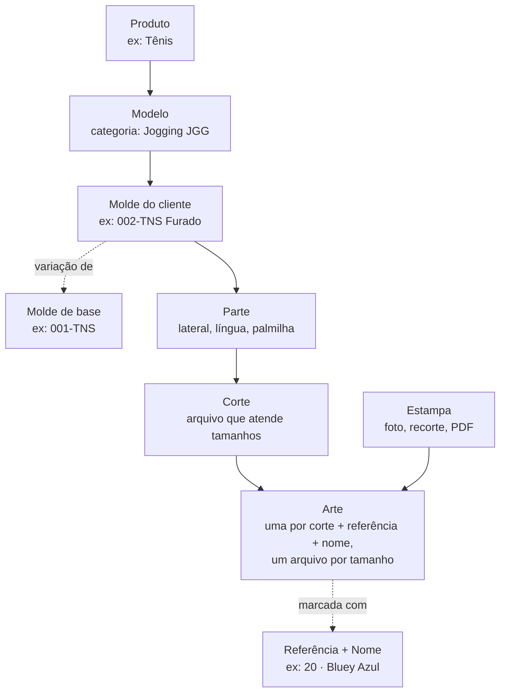
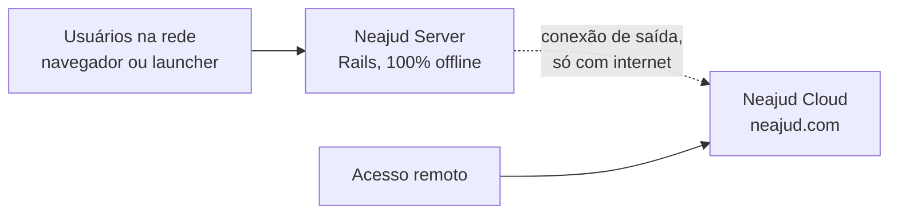

# Neajud — Instruções de Implementação

Atualizado em 30/09/2026

## Contexto e visão

O Neajud evolui de um app Rails interno para um produto vendido como serviço: uma assinatura na nuvem que funciona completa sem instalar nada, com um servidor local opcional para trabalhar sem internet. Este documento orienta o agente de código, fase por fase.

**Para quem:** pequenas produções (gráficas, ateliês, sublimação, frequência, private label) com 4 a 10 usuários.

**A rede:** empresas diferentes trabalham sobre o mesmo catálogo de modelos. Uma sublimação e uma empresa de frequência usam a mesma base de calçado, e cada uma acrescenta sua própria camada. O catálogo compartilhado é o diferencial do produto.

**Princípios que valem para todas as fases:**

- Com servidor local, o trabalho do dia a dia nunca depende da internet.
- No plano local, os dados da empresa ficam no servidor local; a nuvem guarda identidades, licenças e o catálogo compartilhado.
- Nada é apagado fisicamente: exclusões são lógicas e reversíveis.
- Versões publicadas são imutáveis; mudanças geram novas versões e alertas, nunca substituições silenciosas.
- O que é cobrado (nuvem, atualizações) é controlado nos servidores do Neajud, não na máquina do cliente.

## Glossário e modelo de domínio

O domínio tem duas camadas: o catálogo compartilhado entre empresas e a camada privada de cada empresa e seus clientes. Tamanhos existem sempre número a número; o agrupamento acontece nos cortes.

Produto, Modelo e Molde são obrigatórios para organizar; de Produto a Corte é catálogo. Referência e Nome são marcações que agrupam as artes de um molde. Estampa e Arte são privadas da empresa e do cliente. Exemplo real (MKS): Tênis › Tenis [TNS] › molde 001-TNS (e as variações 002-TNS Furado e 003-TNS Velcro) › Lateral, Língua › cortes › artes marcadas "20 · Bluey Azul".

Definido em sessão (29/09/2026); a mesma nomenclatura serve para roupas e acessórios no futuro.

| Termo | No código hoje | Definição |
| --- | --- | --- |
| Produto | não existe | Categoria ampla, obrigatória: calçado, camisa, banner (lista oficial na Etapa 1.1, 3/5). Tem a grade de tamanhos individuais |
| Modelo | `Molde` (vira `Modelo` na Etapa 1.1) | Categoria de estilo, obrigatória, com abreviação: Jogging [JGG], Tenis [TNS], Flip Flop, Slide |
| Molde | `Modelo` (vira `Molde` na Etapa 1.1) | Forma de um cliente, obrigatória. Código fixo `NNN-ABR` (número sequencial por cliente, somando todas as categorias, + abreviação do modelo) e sufixo livre opcional ("002-TNS Furado"). Pode ser variação de outro molde |
| Referência | não existe | Agrupador opcional de artes dentro de um molde (ex: 19, 20, Fuel, Elite). Escolhida num select com "criar nova". Não mexe em partes nem cortes |
| Nome | não existe | Texto da arte que agrupa as artes de uma mesma estampa/cor dentro da referência (ex: "Bluey Azul"). Substitui a ideia de "cor" |
| Parte | `Peca` | Pedaço do produto: lateral, língua, correia, cabedal, knit |
| Tamanho | `Tamanho` | Unidade individual da grade do produto: 33, 34, 35...; P, M, G são rótulos de agrupamento no corte ou a grade própria do DTF |
| Corte | `Arquivo` corte (DXF) + `Tamanho` | Arquivo de uma parte que atende um conjunto de tamanhos, com um tipo de grade (Par, Ímpar, P/M/G, Furada) e rótulos (29-30, P) |
| Estampa | não existe | Material de origem do cliente: foto, recorte, arquivo, PDF de instruções |
| Arte | `Arquivo` arte | Arquivo de produção derivado da estampa; uma por corte + referência + nome |
| Etiqueta DTF | não existe | Arte sem corte, numerada (`DTF-863`), com grade P/M/G ou numérica; cada tamanho tem a medida do arquivo |
| Estampa corrida | não existe | Módulo que o RIP repete ao longo do tecido (`CR-4114`); pedida em metros lineares sobre um material |
| Cor lisa | não existe | Cor desenvolvida para casar com um material de referência (`Amarelo v42`), com a família reconhecida pelo tom do arquivo; material e cliente opcionais; pedida em metros como tecido liso |
| Processo | não existe | Tipo de trabalho da empresa: sublimação, frequência, bordado, silk |

**Regras do domínio** (respondidas uma a uma com o dono em 29 e 30/09/2026):

*Catálogo oficial e molde*

- Produto, Modelo (categoria, com abreviação) e a grade de tamanhos são **fixos, oficiais do Neajud**, iguais para todas as empresas (é o que garante a paridade entre elas e o compartilhamento da Fase 9). São configurados numa área de super-admin do Neajud, a mesma dos preços dos planos (Fase 7); até ela existir, a lista vem junto com o sistema, mantida pelo Neajud. A empresa não cria nem edita categorias; pede ao Neajud. Cada categoria pertence a um único produto, com abreviação única.
- O molde pertence a um cliente e escolhe **o intervalo da grade** que usa (ex: 001-TNS do 24 ao 34). As **partes são do molde**: cada forma tem as suas.
- Código do molde `NNN-ABR`: o número é sequencial por cliente, somando todas as categorias, e **nunca é reutilizado** (nem depois de excluir). O número é fixo; a abreviação acompanha a categoria (movido para Jogging, o 002-TNS vira 002-JGG). Sufixo livre ("Furado").
- Mudou o corte de uma parte (um detalhe, um furo, um velcro): é um novo molde, **variação de outro** (campo único `variacao_de`; na Fase 5 ele ganha a versão da base). Até a herança da Fase 5, um corte que serve a vários moldes (a Língua do 001, 002 e 003-TNS) continua ligado a todos eles, como hoje.
- O corte é o mesmo e muda só a arte: é outra referência ou outro nome, nunca outro molde.

*Referência, nome e arte*

- **Cada molde tem as suas referências** (o "20" do 001-TNS e o "20" do 002-TNS são registros diferentes). O mesmo nome em clientes diferentes são produtos diferentes.
- **Uma arte por molde + referência + nome**, sem exceção, com **um arquivo por parte × tamanho** (decidido em 02/10/2026; antes era "uma arte por corte", uma por parte). Ex: "001-TNS · 19 · BLUEY PTO" tem o Lateral e a Língua, cada um nos seus tamanhos (hoje muitas só têm o 30; com o tempo, terão todos). Trocar um arquivo é subir uma nova versão dele. Na galeria aparece um card por arte, e a página dela lista os arquivos por parte e tamanho, para baixar. Assim o pedido (Etapa 1.2, 3/3) aponta para uma arte só e acha nela a parte e o tamanho, sem depender de os nomes das partes baterem.
- **Piloto e produção** (decidido em 05/10/2026): cada parte de uma arte tem **um piloto** — o arquivo editável e pesado (ex: um TIF de 78 MB com camadas) — e a sua **grade de produção**, os arquivos leves do dia a dia. Um arquivo com as duas partes juntas é raro e fica de fora (o piloto sempre tem parte). O piloto **entra na foto da aprovação**: uma versão nova dele volta a arte para "não enviada" (mudar o piloto deve mudar a produção), e os arquivos de produção daquela parte feitos antes dessa versão ficam marcados "anterior ao piloto atual" até ganharem versão nova (só aviso). O piloto não conta como "arte repetida" do arquivo de produção do mesmo tamanho; na arte repetida, além de "tornar nova versão", há "tornar o piloto desta parte".
- **Pedido de amostra usa o piloto** (decidido em 05/10/2026, para a Etapa 1.2, 3/3): a decisão é **por arte dentro do pedido**, automática pelos tamanhos — uma arte pedida só no tamanho do piloto, sem arquivo de produção nesse tamanho, vai com o piloto ("piloto (amostra)" na produção); havendo o arquivo de produção, ele vai; com mais tamanhos, só produção (o que faltar é pendência).
- **Juntar e separar à mão** (decidido em 02/10/2026): na conferência do upload e na página da arte. Na página, "trazer outras artes para esta" (decidido em 05/10/2026): cards com a prévia de cada arte e um filtro por nome, marcando várias de uma vez (da página do P, marcar o M e o G); os arquivos delas passam a esta e adotam o molde, o cliente, a referência e o nome dela; recusado, sem mover nenhuma, se mudaria o molde ou o cliente de um arquivo. "Separar" tira um arquivo para uma arte sozinha. Uma arte com o mesmo molde, referência e nome noutra arte é sugerida, com a prévia, para trazer. Cada arquivo da lista mostra a sua miniatura.
- **Aprovação do cliente por arte** (decidido em 02/10/2026): um envio e um registro valem para a arte inteira, guardando as versões de cada arquivo naquele momento. Uma versão nova de um arquivo aprovado volta a arte para "não enviada" ("alterada depois da aprovação"); uma parte ou tamanho acrescentado depois **mantém** a arte aprovada, com o arquivo novo marcado "depois da aprovação". Feito na Etapa 1.2 (2/3, parte 2), em 05/10/2026: a aprovação guarda a versão em uso de cada arquivo ("foto"); só a mais recente conta, e enquanto os arquivos que ela viu mantêm aquelas versões; o card da galeria mostra o selo.
- **Agrupamento no upload** (decidido em 30/09/2026, o mesmo para artes, etiquetas DTF, estampas corridas e cores): arquivos de um mesmo envio com o mesmo nome, tirando parte, tamanho e medida, viram uma arte só, com a parte e o tamanho lidos do nome. O **número do começo é a referência e separa artes** (decidido em 02/10/2026: "20-BLUEY AZUL" e "41-BLUEY AZUL" são artes diferentes; o "863/864/865-ARCOVERDE" do DTF é juntado à mão até a numeração automática da Fase 2). Antes de salvar, uma tela mostra o agrupamento ("ARCOVERDE: P, M, G") para separar, juntar ou trocar o tamanho. Depois, dá para acrescentar um tamanho pela página da arte.
- Nome completo da arte, calculado e nunca gravado: `código do molde_referência_nome_parte_tamanho`, ex: `001-TNS_19_Bluey Azul_Lateral_29-30`. Com acento na tela; **sem acento no arquivo baixado**. Peças vazias são puladas; o nome original do upload continua guardado.
- O Nome é pré-preenchido a partir do arquivo ("19-BLUEY PTO" → "BLUEY PTO"), com sugestões dos nomes já usados na referência, comparados sem maiúsculas, acentos e ç/c.

*Tamanhos e grade*

- Tamanhos são sempre individuais. O agrupamento é definido na **organização do DXF**: cada tamanho do corte declara os números que atende e tem um rótulo, que é o que entra no nome da arte (o par "29-30"). O corte tem um **tipo de grade** (decidido em 30/09/2026):
  - **Par**: pares que terminam em número par (29-30, 31-32);
  - **Ímpar**: pares que terminam em número ímpar (30-31, 32-33);
  - **P/M/G**: rótulos (PP, P, M, G, GG, XG), cada um dizendo os números que atende;
  - **Furada**: faixas irregulares com nome descritivo (20-21, 24-25-26, 30, 31-32-33-34), de onde o sistema lê os números atendidos; o rótulo é opcional e, sem ele, vale o nome.

  O sistema deduz o tipo pelo nome dos tamanhos ("34-35", "P", "24-25-26") ou pela quantidade e sequência deles (de 2 em 2 terminando em par = Par; em ímpar = Ímpar) e já preenche os campos; em P/M/G e Furada, uma coluna de rótulo entra antes do campo de tamanho. Se não deduzir, a pessoa escolhe o tipo e preenche.
- **P/M/G sem padrão travado**: num corte (ex: o Knit de um slide), cada molde define quais números o P, o M e o G atendem. P/M/G também é uma **grade própria** nos trabalhos sem corte (DTF), em que cada tamanho é uma medida largura × altura lida do arquivo.
- Os cortes de cada parte cobrem **o intervalo do molde**, sem buracos nem sobreposição. Isso é um **aviso, nunca um bloqueio** (decidido em 01/10/2026).
- O pedido de calçado entra sempre por tamanho individual; a produção encontra o corte que atende aquele tamanho e, dele, o arquivo da arte naquele tamanho. Sem esse arquivo, o pedido não confirma (pendência).

*Trabalhos sem corte (decidido em 30/09/2026; todos entram no beta, Fase 2)*

- **Etiqueta DTF**, **estampa corrida** (contínuo) e **cor lisa** não têm molde nem corte. Os dois primeiros têm a marcação **"entra no catálogo"**: desmarcada (padrão), o trabalho é só do cliente dele, que é obrigatório; marcada, fica aberto a todos os clientes da empresa (a "coleção geral"), e o cliente passa a ser opcional. A cor lisa **entra no catálogo por padrão**.
- **Família da cor lisa, automática** (decidido em 30/09/2026): a pessoa sobe só o arquivo (com qualquer nome) e escolhe o material; o sistema mede a cor média (CMYK convertido pelo perfil ICC, como nas prévias) e acha a família pelo tom, com luminosidade e saturação separando bordô e marrom de vermelho e laranja, e branco, cinza e preto das cores. As famílias e as faixas são **fixas, do Neajud** (como o catálogo oficial). O nome sai sozinho, `Amarelo v43`: a sequência conta **por família, na instância**, sem olhar o material. Medido nas amostras: amarelos em 84–101°, laranjas em 42–48°, azul em 271°, bordô em 11° com luminosidade 24.
- **A cor medida em Lab, com o calibrador por foto em mente** (decidido em 12/10/2026, revendo a família pelo matiz HSL acima): cada cor lisa guarda a sua cor em **CIE Lab** (o CMYK do arquivo convertido pelo perfil ICC, com o ImageMagick que já existe); a família sai do matiz em **LCh** (as faixas medidas em HSL serão refeitas em LCh), e as cores se comparam pelo **ΔE2000** (Ruby puro, sem dependência nova). Ao subir uma cor, o sistema avisa **"já existe uma parecida"** (a cor e o ΔE), para não desenvolver a mesma cor duas vezes; a tela **"todas as cores"** mostra a cartela de ladrilhos (matiz × claridade) e a tabela. Opcional logo depois: a **impressão de teste numerada** (`T-000123`, grade de 5 × 7 variações em volta do alvo, gerada em TIFF CMYK), escolhida **a olho**, com os ajustes ("mais claro", "menos azul") como deslocamentos em Lab, rodadas e a receita final. O **calibrador por foto** completo (cartões com marcadores ArUco, perfil por impressora, medição pela câmera) fica para depois do beta, especificado em `docs/cor-lisa/calibrador-de-cor.md` (layouts em `docs/cor-lisa/cartoes-de-calibracao.html`): antes, um protótipo Python fora do app valida a precisão (ΔE 2–5) com os celulares e a luz da fábrica; no lugar do app Android, uma página do Neajud com o upload da foto pelo navegador do celular (os patches do cartão corrigem a luz e a câmera).
- A numeração que hoje é feita à mão passa a ser automática e nunca reutilizada: `DTF-863` (por etiqueta, compartilhado pelos tamanhos), `CR-4114` (estampa corrida) e `Amarelo v42` (variação por família de cor). Cada empresa começa do 1 (`DTF-1`, `CR-1`, `v1`); não há migração dos números atuais: o número antigo continua no nome original do upload, que é guardado e pesquisável.

*Arte e processo*

- A Arte tem um arquivo de origem (PSD, CDR, AI, PNG, TIFF, JPG) e saídas de produção (TIFF em ultra resolução e JPG compactado para bitmaps, PDF para vetores).
- Cada empresa acrescenta sua camada de processo sobre as partes do catálogo, referenciando a parte pelo UUID.

**Estampa ⇄ Arte (em definição):** as duas se correlacionam, mas podem funcionar juntas ou separadas. Uma arte pode existir sem estampa, e uma estampa sem artes. A ligação entre elas é opcional e o formato final ainda será decidido.

## Arquitetura alvo

A nuvem é o produto principal: qualquer cliente que assina usa o Neajud completo, sem instalar servidor. O servidor local é uma facilidade opcional para trabalhar offline, e o launcher facilita o acesso.

| Componente | Repositório | Responsabilidade |
| --- | --- | --- |
| Neajud Server | `neajud` | Opcional, para trabalhar sem internet: roda num PC dedicado e atende a rede local |
| Neajud Cloud | `neajud-cloud` (novo, Rails separado) | Produto principal: hospeda o Neajud completo para quem assina, sem instalar nada. Também cuida de contas, perfis, licenças, pareamento, catálogo compartilhado, atualizações e acesso remoto aos servidores locais |
| Launcher | `neajud-launcher` (novo, Tauri) | Login, acesso à nuvem e aos servidores locais da conta, descoberta na rede via mDNS |

**Regras de arquitetura:**

- O servidor sempre inicia a conexão com a nuvem; nunca abre portas no roteador do cliente.
- A stack do servidor não muda: Rails 8, Hotwire, Stimulus, Importmap, SQLite, Solid Queue, Solid Cache, Solid Cable.
- Para quem tem servidor local, a nuvem não guarda cópia dos dados da empresa; o acesso remoto passa por um túnel até ele.
- A API entre servidor e nuvem é versionada (`/api/v1`) e aceita servidores de versões anteriores durante o prazo de adiamento de atualização.

**Dois planos, lançados em sequência (hospedado primeiro; local depois, junto com o launcher):**

- **Hospedado:** o cliente assina e usa em `neajud.com`, sem servidor próprio. Roda um Neajud Server por cliente na infraestrutura do Neajud.
- **Local:** opcional, para quem precisa trabalhar sem internet: o cliente instala a ISO num PC dedicado.

Os dois rodam o mesmo código e o mesmo formato de backup; migrar um cliente de um plano para o outro é restaurar um backup.

## Usuários e permissões

A conta é da pessoa; o acesso a cada empresa é um vínculo com uma função (editável pelo dono, 27/09/2026) e acessos extras.

**Pessoa, empresa e vínculo:**

- A conta é única, na Neajud Cloud, e pertence à pessoa.
- Um vínculo liga a pessoa a uma empresa com uma função e, se preciso, acessos extras. A mesma pessoa pode ser designer numa empresa, cliente de outra e dona da própria.
- Qualquer pessoa pode criar uma empresa, que começa no teste grátis.
- O login acontece na nuvem; a pessoa escolhe a empresa e é enviada à instância dela já autenticada. O servidor local mantém cópia dos vínculos da sua empresa para login offline.

**Dono e admin:**

- **Dono:** responsável pela conta. Cuida de plano, pagamento e licença; transfere a posse ou encerra a empresa; libera o acesso do suporte e é notificado dele; restaura excluídos; nomeia e remove admins. Toda empresa tem pelo menos um dono, e pode ter mais de um. Nenhum admin remove ou bloqueia um dono.
- **Admin:** administra o dia a dia: usuários, perfis, configurações, catálogo e aprovação de atualizações. Não mexe em cobrança, não encerra a empresa, não restaura excluídos.
- Se a empresa ficar sem dono acessível, a recuperação é feita pelo suporte, com verificação de identidade.

**Atualizado em 27/09/2026 — funções editáveis pelo dono.** Os perfis fixos abaixo viraram o **ponto de partida** de uma política que o dono edita na tela Funções: uma grade área × função com os níveis — / Ver / Editar / Excluir (cada nível inclui os anteriores), mais ações especiais. O dono também cria funções novas (no chão de fábrica, vários funcionários usam a mesma função). Cada pessoa tem **uma função**, e pode receber **acessos extras** que só aumentam o que a função dá. A Lixeira entrou como área (— / Ver / Restaurar), liberada pelo dono a quem ele quiser. O dono tem tudo e sua função não é editável; editar funções é só do dono. Evolução prevista: agrupar funções por **setor**. Motor próprio (sem Oso, cuja política fica num serviço externo, nem Action Policy, cujas regras ficam em código); se as regras por registro crescerem (cliente final), o motor pode mudar por baixo da classe `Autorizacao`.

**Funções padrão** (o ponto de partida da grade, que o dono edita; empresa de uma pessoa só tem o dono com tudo):

| Ação | Dono | Admin | Atendimento | Designer | Produção | Cliente final |
| --- | --- | --- | --- | --- | --- | --- |
| Criar e editar pedidos | ✓ | ✓ | ✓ |  |  |  |
| Ver pedidos | ✓ | ✓ | ✓ | ✓ | ✓ | só os seus |
| Cadastrar clientes | ✓ | ✓ | ✓ |  |  |  |
| Criar estampas e artes | ✓ | ✓ | ✓ | ✓ |  | envia material |
| Catálogo (moldes, partes, cortes) | ✓ | ✓ |  | ✓ |  |  |
| Baixar saídas de produção | ✓ | ✓ |  | ✓ | ✓ |  |
| Atualizar status da produção | ✓ | ✓ |  |  | ✓ |  |
| Aprovar arte | ✓ | ✓ | ✓ | ✓ |  | ✓ |
| Compartilhar com outras empresas | ✓ | ✓ | ✓ | ✓ |  |  |
| Gerenciar usuários | ✓ | ✓ |  |  |  |  |
| Cobrança e plano | ✓ |  |  |  |  |  |
| Restaurar excluídos | ✓ |  |  |  |  |  |

Um perfil Financeiro não é mais uma decisão pendente: com as funções editáveis, o dono cria essa função quando precisar.

**Cliente final:** vínculo do tipo cliente. Vê apenas os próprios pedidos, estampas e artes; envia material e aprova artes. Pode criar a própria empresa a partir da conta, entrando no teste grátis.

**Aprovação de arte:** é um registro formal e não bloqueia a produção. Guarda quem aprovou, quando e qual versão, distinguindo dois casos:

- "Aprovada pelo cliente no sistema", quando o próprio cliente aprova;
- "Aprovação registrada por [nome], cliente aprovou por [canal]", quando a equipe registra, com o canal informado e anexo opcional.

O pedido mostra o estado de cada arte: aprovada, aguardando aprovação ou produzida sem aprovação.

**Suporte do Neajud:** acima de todas as empresas, via painel de suporte e impersonação (Etapa 7.2). O acesso está declarado nos termos de uso, fica registrado e o dono é notificado.

## Regras para o agente

O AGENTS.md do repositório continua valendo; estas regras se somam a ele.

**Processo:**

1. Uma fase por vez, e dentro dela uma etapa por PR. Features grandes viram séries encadeadas (1/N, 2/N), como já é feito.
2. Antes de mudar código: localizar o existente, entender, reutilizar. Ao terminar: rodar `bin/rspec`, `bash bin/e2e`, RuboCop, Brakeman e `bin/check-residues`.
3. Ao fim de cada etapa: listar arquivos alterados, explicar o que mudou, informar os testes executados e os problemas encontrados, e aguardar validação humana. O merge é sempre humano.
4. Commits no padrão Conventional Commits (`feat:`, `fix:`, `refactor:`, `test:`, `docs:`), porque as notas de versão serão geradas a partir deles.
5. Toda migração que transforma dados roda sobre uma cópia (`bin/dev-backup`) e tem rollback testado.

**Não fazer:**

- Não reescrever a aplicação nem trocar o frontend (sem React, Vue ou similares).
- Não usar `default_scope` para esconder registros excluídos.
- Não apagar registros fisicamente, exceto na anonimização de dados pessoais.
- Não processar PSD, TIFF, AI, EPS ou PDF dentro do request web.
- Não adicionar dependências sem justificar no PR.
- Não criar abstrações antes de existir um segundo uso real.

## Ordem de execução

A nuvem é lançada primeiro; o servidor local sai depois, junto com o launcher (Tauri). As fases estão numeradas na ordem em que devem ser feitas.

| Fase | O quê | Por quê nesta posição |
| --- | --- | --- |
| 0 | Fundações | Caro mudar depois que houver dados de clientes reais |
| 1 | Modelo de domínio | Idem: renomear, UUID e tamanhos individuais antes dos dados reais |
| 2 | Pronto para o beta | O que o chão de fábrica precisa no primeiro dia, incluindo DTF, estampa corrida e cor lisa; não depende da nuvem |
| 3 | Operação na nuvem | O produto principal é o plano hospedado; montada logo antes do beta, para não manter infraestrutura sem cliente (ordem trocada em 30/09/2026) |
| 4 | Lançamento beta | 2 ou 3 clientes, começando pela sublimação |
| 5 | Catálogo versionado com herança | Acrescentado sem migração destrutiva sobre as colunas da Fase 1 |
| 6 | Estampas e Artes | Depois do beta |
| 7 | Nuvem: contas, cobrança e suporte | Quando houver mais clientes |
| 8 | Servidor local e launcher | Lançados juntos, depois da nuvem |
| 9 | Compartilhamento entre empresas | Depende do catálogo versionado e da nuvem |

Regra de prioridade: fazer agora tudo que é caro mudar depois que houver dados de clientes reais; adiar o que pode ser acrescentado sem migração.

## Fase 0 — Fundações

Antes de qualquer recurso novo, corrigir o que conflita com as decisões deste documento.

**Etapa 0.1 — Higiene do repositório.** Tornar o repositório privado (feito em 26/09/2026), atualizar o README com o domínio real do sistema (feito no PR #98) e adicionar `test-results/` ao `.gitignore` (feito em 26/09/2026). Etapa concluída.

**Etapa 0.2 — Auditoria.** Sem alterar código, produzir `docs/current-state.md` com: models, controllers, services, jobs, rotas, autenticação, uso de UUID por entidade, exclusões físicas existentes e onde o processamento de arquivos roda. Marcar o que é específico de sublimação e o que é estrutura genérica do catálogo. Concluída em 26/09/2026: `docs/current-state.md`.

**Etapa 0.3 — Processamento em fila.** O upload hoje roda o `ArquivoProcessingJob` inline no POST. Passar para Solid Queue, com a interface mostrando o estado (na fila, processando, pronto, erro) via Turbo Streams. Ajustar os specs E2E para esperar o estado final. Concluída em 26/09/2026 (upload, nova versão e "Enviar arquivo"; em desenvolvimento e no E2E a fila e o cable rodam como na produção: Solid Queue no Puma e Solid Cable).

**Etapa 0.4 — Exclusão lógica.** Substituir exclusões físicas — hoje todas as rotas DELETE apagam de verdade: arquivos (incluindo o destroy em lote), clientes, modelos, moldes, peças, pedidos e a remoção de item de pedido — por:

- colunas `deleted_at`, `deleted_by_id`, `restored_at`, `restored_by_id`;
- escopos explícitos (a gem `discard` ou equivalente), sem `default_scope`;
- registro excluído continua visível onde já foi usado (pedidos, relatórios), com o selo "excluído em";
- validação no model que impede associar registro excluído a registros novos;
- restauração permitida só ao dono da empresa.

Concluída em 26/09/2026. Decisões desta etapa:

- **Onde entra:** arquivos (inclusive o lote), clientes, modelos, moldes, peças e pedidos vão para a lixeira (`/lixeira`), que lista tudo com o botão Restaurar. Remover um item ou zerar uma grade de um pedido em **rascunho** continua físico: é edição em andamento, e o pedido inteiro é que vai para a lixeira.
- **Sem cascata:** excluir um cliente, modelo ou molde não mexe no que depende dele (antes, excluir um cliente apagava os modelos e o estoque dele). Os dependentes continuam e mostram o selo.
- **Nome repetido:** cadastrar um nome que está na lixeira é recusado com um aviso para restaurar, para não haver dois registros iguais depois da restauração.
- **Quem:** até a Etapa 0.5, quem excluiu ou restaurou fica registrado pelo IP em `exclusao_logs`; `deleted_by_id` e `restored_by_id` já existem e ficam vazios até haver usuários. Até lá qualquer pessoa restaura; a 0.5 restringe ao dono.
- **Arquivos em disco:** ficam, para que pedidos e restaurações continuem com as prévias. Apagar de vez (esvaziar a lixeira) fica para quando houver necessidade.
- **Pedido em rascunho** que usa uma arte ou um corte na lixeira não pode ser confirmado (nova pendência "está na lixeira"). Um pedido na lixeira continua abrindo, mas fica congelado até ser restaurado.
- Escopos próprios (`Excluivel`: `ativos`/`excluidos`, `excluir!`/`restaurar!`) em vez da gem `discard`, sem dependência nova; nenhum `default_scope`.

**Etapa 0.5 — Autenticação e perfis.** Se não existir, implementar login local (gerador de autenticação do Rails 8, com `bcrypt`) e perfis: os perfis fixos da seção Usuários e permissões, combináveis no mesmo vínculo. Modelar desde já pessoa e vínculo (pessoa × empresa × perfis) e o registro de aprovação de arte, prevendo a ligação com a conta na nuvem (`cloud_user_uuid` opcional).

Dividida em quatro PRs (decidido em 27/09/2026; eram três, a política editável dividiu o antigo 2/3):

- **1/3 — Login e modelo de acesso** (concluída em 27/09/2026): login por e-mail e senha; `User` (a "pessoa" do plano; o nome em inglês foi escolhido para seguir o gerador do Rails), `Empresa` (uma por instância) e `Vinculo` com perfis; primeiro acesso por uma tela de configuração que cria a empresa e o primeiro dono e depois se fecha; os registros de autoria passam a guardar o usuário (além do IP). Sem recuperação de senha por e-mail: dono ou admin redefine (2/3); o e-mail vem com a conta na nuvem (Etapa 7.1).
- **2/4 — Política** (concluída em 27/09/2026): funções editáveis pelo dono (grade de níveis por área + ações especiais, criar e excluir funções), aplicadas no servidor (403) e na tela (menus e botões). As funções padrão (Dono, Admin, Atendimento, Designer, Produção) seguem a tabela acima.
- **3/4 — Usuários** (concluída em 27/09/2026): tela de usuários com função, acessos extras (só aumentam o que a função dá), senha provisória (a pessoa escolhe a própria no primeiro login), redefinir senha e desativar/reativar (nunca excluir). Regras: só o dono mexe em donos e dá a função Dono; ninguém dá mais acesso do que tem; a empresa sempre mantém um dono ativo; ninguém desativa a si mesmo. Qualquer pessoa troca a própria senha pelo nome no cabeçalho.
- **4/4 — Aprovação de arte** (concluída em 28/09/2026): registro formal pela equipe (canal, data, observação e anexo opcional — print ou PDF), por versão; nunca bloqueia a produção. **Só existe depois de "Enviar para aprovação"** (decidido antes do merge): sem envio, a arte não mostra selo nem botão; enviada, fica "aguardando" e pode ter a aprovação registrada; uma versão nova volta a "não enviada". Aparece na página da arte (estado + histórico, com cancelamento que fica registrado) e no pedido (selo em cada peça: aprovada, aguardando, ou "confirmado sem aprovação" em pedido confirmado), com "Registrar aprovação" dos dois lugares. Nova ação especial na grade: "Registrar aprovação de arte" (padrão: Admin, Atendimento, Designer). O antigo "Approve/Approved" das versões virou "Usar esta versão/Em uso". "Aprovada pelo cliente no sistema" chega com o cliente final.

Etapa 0.5 concluída em 28/09/2026.

- **Fora da 0.5:** o cliente final (vínculo ligado a um Cliente, tudo filtrado por ele) vira a Etapa 2.8, antes do beta; setores, depois.

**Etapa 0.6 — Trabalho pesado restante fora do request.** A auditoria (Etapa 0.2) achou, além do upload, trabalho pesado que ainda roda no request: o `MoldMatchService` (ImageMagick) ao escolher o modelo de uma arte, as prévias dos tamanhos na organização do DXF e a extração do DXF de um tamanho no primeiro download. Levar para o Solid Queue com o mesmo padrão da Etapa 0.3 (estado visível e atualização da tela por broadcast).

Dividida em três PRs (decidido em 28/09/2026), um por trabalho pesado, medidos no dev: comparação de moldes até 37 s; extração do DXF ~0,5 s por tamanho.

- **1/3 — Tamanho automático** (concluída em 28/09/2026): ao escolher o modelo, a busca roda na fila; a seção de tamanho mostra "Procurando tamanho…" e o tamanho aparece sozinho quando termina (atualização ao vivo, com consulta periódica de reserva).
- **2/3 + 3/3 — Preparar os tamanhos do corte** (juntas num PR, concluídas em 29/09/2026: a prévia e o DXF de cada tamanho saem da mesma extração): organizar o DXF e salvar as camadas só gravam a escolha; um job detecta de novo quando preciso, extrai o DXF de cada tamanho e gera a prévia. A página mostra "Preparando os tamanhos…" e se atualiza ao terminar. O download da produção usa o DXF já pronto; se pedirem antes, extrai na hora no mesmo lugar.

Etapa 0.6 concluída em 29/09/2026.

## Fase 1 — Modelo de domínio

A estrutura que é cara de mudar depois: nomes, identificadores e a forma como tamanhos e cortes se relacionam.

**Etapa 1.1 — Hierarquia.** Cinco PRs em série (decidido em 29/09/2026; revisto em 30/09/2026: a estrutura virou quatro PRs para a troca de nomes não carregar regras novas).

**Sem migração de dados (decidido em 30/09/2026):** o beta começa com o banco vazio e cada cliente sobe tudo de novo (clientes, moldes, cortes, artes, pedidos, estoque). As migrações da Fase 1 só mudam o esquema, sem preservar os dados atuais, que são amostras; antes de aplicá-las no desenvolvimento, `bin/dev-backup`.

- **1/5 — UUID em tudo.** Coluna `uuid` (única, gerada na criação) onde faltar, mantendo o ID inteiro como chave interna. Rotas e qualquer referência externa passam a usar o UUID. Nada muda na tela, só os endereços. Concluída em 30/09/2026: "referência externa" é tudo o que sai do servidor (URLs, JSON, valores de formulário), e o id inteiro responde 404; parâmetros com o sufixo `_uuid` (convenção no AGENTS.md).
- **2/5 — Troca de nomes.** O `Molde` atual (categoria) vira `Modelo` e o `Modelo` atual (forma do cliente) vira `Molde` em tabelas, colunas, classes, rotas, telas, JS e testes, com nomes intermediários na migração. Sem mudança de comportamento: os testes existentes, renomeados, continuam passando.
- **3/5 — Catálogo oficial.** Produto (com a grade de tamanhos individuais) e Modelo (categoria, com abreviação), vindos da lista oficial do Neajud em `config/catalogo_oficial.yml` (decidido em 30/09/2026): uuids fixos iguais em todas as empresas, carregada no deploy e no `db:prepare` por uma tarefa que pode rodar de novo sem duplicar; item que sai da lista vai para a lixeira; a empresa só vê, não edita; na Fase 7 a área de super-admin substitui o arquivo. Lista inicial:

  | Produto | Grade | Modelos |
  | --- | --- | --- |
  | Calçado | 18 a 46, número a número | Tenis [TNS], Jogging [JGG], Bota [BT], Calce Fácil [CLCF], Chuteira [CHT], Chinelo [CHN], Slide [SLD] |
  | Camisa | PP, P, M, G, GG, XG (numerações depois) | Camisa [CMS] |
  | Banner | sem grade (a medida vem com os trabalhos sem corte, Fase 2) | Banner [BNN] |

  O molde escolhe o intervalo da grade que usa. **As partes são só do molde**: a categoria deixa de ter peças; as Peças continuam uma lista da empresa (Lateral, Língua…), e cada molde escolhe as suas e marca "corta/não corta". Concluída em 30/09/2026. No caminho: como todo cliente usa o mesmo "Tenis", as buscas que caíam em "cortes da mesma categoria" (`Arquivo.cortes_do_molde`, `MoldMatchService`) passaram a ficar dentro do cliente — sem isso, uma arte pegava o corte e os tamanhos de outro cliente.
- **4/5 — Código do molde.** Código fixo `NNN-ABR` (número por cliente, somando todas as categorias, nunca reutilizado: a MKS com jogging vira 004-JGG), sufixo livre, `variacao_de` (a variação nasce com as partes da base copiadas; a herança de verdade é a Fase 5) e as colunas `version`, `base_id` e `published_at` (antiga Etapa 1.3). Concluída em 30/09/2026: o cliente do molde fica fixo depois de criado; um molde pode ser variação de outro de **outro cliente** (segue a numeração do seu cliente) e nasce com modelo, grade, partes e **ligações com os cortes** da base copiadas.
- **5/5 — Referência e Nome.** Referência (de um molde, select com "criar nova") e, na arte, `referencia` e `nome`, com o nome completo calculado, o pré-preenchimento e as sugestões descritos nas regras do domínio, e a trava de uma arte por corte + referência + nome. Concluída em 01/10/2026: referência e nome são preenchidos sozinhos ao escolher o molde, lidos do nome do arquivo (a referência é criada no molde se faltar); a "trava" virou um aviso — a arte repetida (mesmo nome completo) oferece "tornar nova versão" da primeira; até a Etapa 1.2 juntar os tamanhos numa arte só, o tamanho entra na comparação.

Exemplo de como os dados reais ficam na nova estrutura (serve de roteiro para os testes; não é migrado):

| Hoje | Vira |
| --- | --- |
| Molde "Tenis Baixo" | Modelo Tenis [TNS] › Produto Tênis |
| Molde "Jogging" | Modelo Jogging [JGG] › Produto Tênis |
| Modelo "19-20-25" (MKS) | Molde 001-TNS |
| Modelo "21-24" (MKS) | Molde 002-TNS, sufixo "Furado", variação do 001 |
| Modelo "28-29" (MKS) | Molde 003-TNS, sufixo "Velcro", variação do 001 |
| Modelo "NB Fuel" (GMS) | Molde 001-JGG, sufixo "NB"; artes marcadas na referência Fuel |

As referências 19 e 20 da MKS são criadas pela tela.

**Etapa 1.2 — Cortes por tamanho individual.** Três PRs em série (decidido em 30/09/2026). Concluída em 07/10/2026 (PRs #122 a #133); com ela, a Fase 1 está completa.

- **1/3 — Tipo de grade e tamanhos.** Cada tamanho de um corte declara os números que atende e tem um rótulo (o par "29-30"), definido na organização do DXF pelo tipo de grade do corte (Par, Ímpar, P/M/G ou Furada, com dedução automática; regras do domínio). Validar cobertura do intervalo do molde, sem buracos nem sobreposição por parte. Casos reais para testar a dedução (os cortes atuais são amostras, não são migrados): um só número por tamanho é o **último** do par ("24, 26…34" = Par 23-24…33-34; "35, 37…43" = Ímpar 34-35…42-43); nomes escritos ("34-35", "24-25-26") ficam como estão; o que não deduz ("Size 1") a pessoa preenche. Concluída em 01/10/2026: a cobertura do intervalo do molde **avisa sem bloquear** (o molde pode ganhar o intervalo depois, e um corte que atende vários moldes pode estar certo para uns e não para outros) — na página do corte e na parte do molde; salvar a organização atualiza os tamanhos no lugar, sem desligar as artes deles. A detecção lê os números do intervalo no nome do arquivo ("35 AO 43"); sem ele, os tamanhos vêm como "Size N" e a pessoa escolhe o tipo.
- **2/3 — Arte por parte e tamanho.** A arte passa a ter um arquivo por parte × tamanho, com o **agrupamento no upload** e a tela de conferência (regras do domínio); um card por arte na galeria, as partes e os tamanhos na página dela. DTF, estampa corrida e cor lisa reaproveitam esse agrupamento na Fase 2. Em três PRs (decidido em 02/10/2026):
  - **parte 1 — a arte como envelope dos arquivos:** tabela `artes` (cada arquivo continua sendo um `Arquivo`, com versões, processamento e prévia próprios); molde, cliente, referência e nome iguais em todos os arquivos da arte; um card por arte; a lista por parte e tamanho na página, com "acrescentar arquivo", "juntar com outra arte" e "separar"; o tamanho lido do nome do arquivo ("…-29_30", "…-P") é tentado antes das medidas na busca automática. Concluída em 04/10/2026.
  - **parte 2 — aprovação por arte** (regras do domínio). Concluída em 05/10/2026.
  - **parte 2b — piloto de cada parte** (regras do domínio): marcar o piloto na página da arte e na oferta da arte repetida; o aviso "anterior ao piloto atual". Concluída em 05/10/2026.
  - **parte 3 — agrupamento no upload**, com a tela de conferência (inclui marcar o piloto, sugerido pelo peso ou pelo formato PSD/AI/CDR). Concluída em 05/10/2026, com as decisões: a conferência só aparece quando algum grupo junta 2 ou mais arquivos ou há piloto sugerido; uma arte já cadastrada com a mesma referência e nome é **sugerida, nunca marcada** ("Uma nova arte" vem marcado); arquivo sem parte no nome fica com a parte vazia e destacada, para a pessoa escolher (ou vem depois, pelo corte); piloto sugerido = PSD, AI ou CDR, ou 3 vezes ou mais a mediana do peso dos outros arquivos da mesma parte. Nomes diferentes (o piloto "20-BLUEY AZUL" e a produção "20-cachorro marinho") são juntados à mão na conferência ("Join with…").
- **3/3 — Pedido novo.** O pedido passa a ter um tipo, **um por pedido** (decidido em 30/09/2026): calçado agora; DTF e tecido (estampa corrida e cor lisa juntas, no mesmo pedido) na Fase 2. Tipos diferentes são pedidos separados. O pedido de calçado entra por molde + referência + nome (ex: 001-TNS · 20 · Bluey Azul) e tamanho individual, montando sozinho a arte e o corte de cada parte. Um tamanho pedido cuja arte não tem o arquivo daquele tamanho é uma **pendência que bloqueia a confirmação**, como a peça sem arte de hoje (decidido em 30/09/2026). Em três PRs (decidido em 05/10/2026), com as decisões: o item entra **pela galeria e por molde → referência → nome na página do pedido**; a falta de arquivo se resolve **dentro da arte** ("Enviar arquivo" ou "Trazer de outra arte"), o pedido sempre lê da arte; a produção mostra **uma linha por tamanho do corte, com os números dentro** ("29-30: 29×4 · 30×6 = 10") e os downloads; os pedidos de antes (grade pelo nome do tamanho do corte) foram para a **lixeira, só leitura**.
  - **parte 1 — o item é a arte, com grade por número:** `pedidos.tipo` (calçado), `itens_pedido.arte_id`, grade por número, já listada com os números que **os DXF organizados do molde** atendem (sem corte organizado, a numeração completa do produto; o intervalo do molde não entra), com "+ 23" / "+ 35" para o número seguinte da grade do produto, numa tabela responsiva (número em cima e quantidade embaixo; no celular, lado a lado); entrada pela galeria e pelo seletor da página do pedido. Concluída em 05/10/2026.
  - **parte 2 — de onde sai cada número, e as pendências** (parte × número → corte → arquivo, ou piloto na amostra, ou pendência; "Enviar arquivo" / "Trazer de outra arte"). Concluída em 06/10/2026: o "Escolher arte" por peça pendente (ligar outra arte à peça) saiu, pela decisão de resolver dentro da arte.
  - **parte 3 — produção** por parte × tamanho do corte, em três PRs (decidido em 06/10/2026, layout estudado num canvas): **3a** a página do pedido em duas colunas — cada item vira uma matriz (números nas colunas; "Pares" e cada parte nas linhas, com o tamanho do DXF ✓ ou "sem arquivo"), e um painel ao lado com o resumo, o Confirmar e as pendências (uma por parte × tamanho do DXF, com "Enviar arquivo" / "Trazer de outra arte"); **3b** a página de **Corte** da fábrica (uma linha por parte × tamanho do DXF, com a prévia do DXF e o total em peças; "Baixar os DXF (.zip)" com todos os tamanhos), com "peças por par" e "espelhada" em cada parte do molde; as partes "não corta" ficam fora do Corte (decidido em 06/10/2026); **3c** a página de **Impressão** (por arte, um arquivo por linha, em peças, com as partes "não corta"; "Baixar as artes (.zip)"), com o **lado** (direito / esquerdo) em cada arquivo de parte espelhada — dois arquivos, cada lado com a sua pendência; um arquivo **sem lado** vale para os dois até chegar um com lado naquele tamanho (decidido em 07/10/2026); a conferência do upload lê o lado do nome como um pedaço próprio, "DIR" / "ESQ" (ex: "20-BLUEY-LATERAL-29_30-ESQ", decidido em 07/10/2026).

**Etapa 1.3 — Colunas de versão e base.** Absorvida pela 1.1 (4/5): o Molde já nasce com `version`, `base_id` e `published_at`. A Referência não é versionada, porque agrupa artes e não faz parte do catálogo.

## Fase 2 — Pronto para o beta

O que o chão de fábrica precisa desde o primeiro cliente, antes das saídas de produção completas da Fase 6. Decidido em 30/09/2026: além do calçado com corte, o beta já tem **etiquetas DTF, estampa corrida e cor lisa** (regras em "Trabalhos sem corte", no glossário). As etapas estão na ordem de execução (revista em 30/09/2026): as etapas de produção (2.2) vêm antes do DTF e do tecido, que as usam; o cliente final fica por último, porque filtra as consultas de todos os tipos de pedido.

**Etapa 2.1 — Download da arte.** Absorvida pela Etapa 1.2 (3/3, parte 3c, 07/10/2026): a página de Impressão do pedido baixa cada arte com o nome completo (sem acento, com o lado) e todas num zip. Era: na seção Produção do pedido, ao lado do DXF de cada tamanho (já existente), baixar a arte da peça: no mínimo o original aprovado, com o nome completo calculado da arte (`002-TNS_20_Bluey Azul_Lingua_29-30`, sem acento no arquivo). As saídas geradas (TIFF, JPG, PDF) continuam na Etapa 6.3.

**Etapa 2.2 — Ciclo do pedido e etapas de produção.** Rascunho → confirmado → em produção → entregue, com as etapas de produção de cada tipo de item: calçado (imprimir, cortar), DTF em rolo (imprimir) ou cortado (imprimir → cortar), estampa corrida e cor lisa (imprimir no papel → transferir para o tecido; a transferência espera o material quando ele falta).

  Decidido em 07/10/2026, em três PRs:
  - **Etapas por tipo de pedido em `config/etapas_producao.yml`** (a tela para configurar etapas e o que roda em paralelo fica para depois; junto dela, decidir **quem dá baixa em cada etapa** — hoje a ação "Atualizar produção" vale para todas —, por exemplo a conferente estampar os pedidos de reposição: permissão por etapa, a baixa da Conferência da reposição valendo pela Estamparia, ou a baixa da Estamparia na página da Conferência; adiado em 09/10/2026). Calçado: **Impressão** e **Corte** começam juntos; **Estamparia** trava nas duas (sem papel impresso e sem peça cortada não há o que prensar); **Conferência** trava na Estamparia. A parte "não corta" pula o Corte (Impressão → Estamparia → Conferência).
  - **Baixa granular, escolhida na hora**: Impressão, Estamparia e Conferência por parte/tamanho > referência > pedido inteiro; Corte por tamanho > pedido inteiro. Uma baixa num nível maior cobre só as linhas ainda abertas. O botão fica ao lado do download e pede a medida: **metragem** na Impressão (papel) e no Corte (tecido), **quantidade de peças** na Estamparia e na Conferência. O peso do tecido fica para depois (a gramatura é por metro linear).
  - **O esperado vem dos próprios arquivos**, sem cadastro: cada arquivo de arte e cada tamanho do DXF sabem quanto do metro linear uma peça ocupa — a arte pelo retângulo do arquivo na largura do papel (a arte do calçado não gira: a largura do arquivo vai na largura do rolo), o DXF por um encaixe simples das cópias da peça (o eixo vertical do DXF corre ao longo do rolo) na largura do tecido do material, com o giro que cada corte permite — "não pode girar", 180° ou 90°, marcado na página do corte por quem sobe o corte, sem padrão (nem sempre é o mesmo; algumas laterais TNS e BT vão com o lado comprido no comprimento do rolo); até marcar, o consumo não é calculado e o card avisa (decidido em 08/10/2026). Conferido com um encaixe real em 08/10/2026: lateral 29-30 a 1,40 m, 30 peças em 77,12 cm = 38,9/m, o cálculo com 90° dá 39,3; língua 29-30, 65/m real, 64,7 calculado. **Pendente:** uma ilustração do giro e das peças no rolo na página do corte (o `bin/encaixe-dxf.js --svg` já desenha o encaixe); o pedido soma metros por peça × peças. A largura do papel é um parâmetro do dono (a 2.3 o transforma em material).
  - **Aviso abaixo e acima do esperado**, com limites do dono (padrão −10% e +25%); o operador corrige ou confirma, e a baixa fica marcada fora da faixa.
  - **Ciclo**: confirmado → em produção sozinho na primeira baixa; "Marcar como entregue" (avisa o que falta, não trava); entregue fica só leitura; desfazer baixa até a entrega, com histórico; ação nova `atualizar_producao` na grade de Funções.
  - **1/3 — Metros por peça** (concluída em 07/10/2026): os parâmetros do dono (largura do papel e a faixa do aviso), os metros por peça da arte e do DXF (`bin/encaixe-dxf.js`, calculado em fila por largura) e a metragem esperada nas páginas de Corte (por material) e de Impressão. **2/3 — Etapas e baixas** (concluída em 08/10/2026): `config/etapas_producao.yml`, a baixa por linha, referência ou pedido nas páginas de Impressão e Corte e nas novas de Estamparia e Conferência, com o aviso fora da faixa, as travas e a ação "Atualizar produção" na grade de Funções (dada às funções Admin e Produção). **3/3 — Ciclo do pedido** (concluída em 08/10/2026): o pedido vira "em produção" sozinho na primeira baixa e "entregue" pelo "Marcar como entregue", que avisa as etapas em aberto e deixa entregar assim mesmo; entregue fica só leitura. A baixa é desfeita até a entrega (riscada no histórico da etapa, com quem desfez), recusada enquanto uma etapa que dependia dela já usou aquelas linhas; desfeita a última, o pedido volta a "confirmado". O painel e a lista de pedidos mostram o andamento de cada etapa, e a lista filtra por status.
  - **4/4 — Reposição** (decidida em 08/10/2026, revista e concluída em 09/10/2026: a conferência que vem com falta — por linha ou por grupo — abre a contagem linha a linha, cada linha com **☑ Impressão ☑ Corte** marcados, e a conferente desmarca o que não precisa refazer; as peças **acumulam numa reposição em aberto** do pedido, que vai para a produção **sozinha quando a Conferência termina** ou antes pelo botão **"Gerar reposição"**; uma falta depois disso abre outra): na Conferência, uma baixa com menos peças que o esperado **sempre** gera um subpedido de reposição ("Reposição de #…", do mesmo cliente), que já nasce confirmado, conta em **peças** (só as que faltaram, de cada linha, ex.: "Lateral 29-30 ESQ: 1 peça") e passa pelo **processo inteiro** de novo (Impressão → Corte → Estamparia → Conferência). A linha do original fecha com o que foi conferido e aponta para a reposição; os dois pedidos mostram a ligação; uma reposição pode gerar outra. Na entrega, o original **avisa e deixa escolher** se há reposição em produção (entregar parcial ou esperar).

**Etapa 2.3 — Estoque e materiais.** Estoque da empresa (hoje só existe estoque por cliente); o papel de transferência como material, com a sua largura; preço por metro no cadastro de materiais. Baixa automática na confirmação do pedido (tecido do cliente ou da empresa, e o papel); sem saldo, avisa e marca "aguardando material", sem bloquear, porque a impressão no papel pode ser adiantada.

  Decidido em 09/10/2026 (revisto: o estoque fica **lançado à mão** por enquanto):
  - **Estoque em metros lineares.** Cada material é **tecido, papel ou filme** (o filme de dublagem), com **preço de venda por metro** no cadastro; o "valor" das entradas é o custo. Existe o **estoque da empresa** (movimento sem cliente, marcado "Dono: Empresa") além do material de cada cliente, e a página de Materiais mostra o saldo de cada dono.
  - **Papel padrão** nos Parâmetros (um material do tipo papel): a largura dele encaixa as artes; sem papel cadastrado, vale a largura digitada.
  - Concluída em 09/10/2026 nesse escopo. **Para depois, juntos:** a baixa automática do esperado na confirmação (tecido pelo Corte, papel pela Impressão; o tecido do pedido sai **do cliente ou da empresa, escolhido uma vez para o pedido inteiro**; o papel é sempre da empresa e o pedido pode trocar o padrão), o **ajuste pelo real** das baixas de Impressão e Corte, o **"aguardando material"** sem saldo (baixa assim mesmo, saldo negativo, sai sozinho com a entrada) e as telas de **venda de tecido** e de **dublagem**.
  - **Dublagem (para depois, decidido em 09/10/2026):** o dublado é um **material composto** (dois tecidos + o filme, **1 m de cada por metro**; a perda informada em cada dublagem fica para o futuro), com preço sugerido = tecidos + filme e preço final decidido no cadastro. A falta de dublado de pedidos confirmados **acumula numa dublagem em aberto por combinação e por dono**; o botão **"Gerar pedido de dublagem"** passa para o operador; feita, dá saída nos componentes e entrada no dublado. O serviço para o cliente (ele traz os tecidos) entra na dublagem do dono dele, e o dublado volta ao estoque dele e é entregue; cobra-se só o **filme** (o serviço vai embutido no preço do filme). Uma **lista de dublagens** (em aberto, geradas, feitas).

**Etapa 2.4 — Parâmetros e preços do dono.** Largura do filme DTF (60 cm), margem das bordas (1,5 cm), espaçamento padrão, fileiras extras (padrão do dono, alterável no pedido), preço geral por metro do DTF (ex: R$ 120), preço da impressão por metro linear, **o mesmo para estampa corrida e cor lisa** (igual para qualquer largura), custo único do corte por unidade, metragem mínima dos pedidos de tecido e o padrão de "cobrar excedente". Preços acordados por cliente (por metro e/ou por unidade de cada tamanho) valem antes dos gerais. "Cobrar excedente" segue a cascata dono → cliente → pedido. Nova ação na grade de Funções: "aprovar pedido abaixo do mínimo".

  Decidido em 09/10/2026 (feito primeiro para o calçado; o resto entra com a 2.6 e a 2.7):
  - **Calçado é cobrado por par.** O preço fica **no molde**, em faixas de números da grade do produto (ex: 23–30 R$ 9,00; 31–43 R$ 11,00), que não se sobrepõem e podem passar do trecho do molde. Como o molde é de um cliente só, o preço dele já é o preço acordado com o cliente.
  - **Gravado ao confirmar:** cada número da grade do pedido guarda o preço da hora; mudar o molde depois só alcança rascunhos.
  - **Sem preço, não confirma:** um número sem preço (ou a arte sem molde) é uma pendência como as outras, com o link para o molde.
  - **Custo por par**, sempre estimado na hora: os metros de impressão de cada arquivo da arte naquele tamanho × peças por par × **custo da impressão por metro** (papel, tinta e máquina, um valor só), mais as peças cortadas × **custo do corte por peça** — os dois nos Parâmetros. Os metros são o caminho para o custo por par, base da futura **calculadora de preço**. O tecido fica fora até a origem do tecido por pedido (Etapa 2.3, adiada).
  - **Para a calculadora de preços (analisado em 09/10/2026): o custo do corte automatizado**, no lugar do custo por peça digitado. O dono informa o **valor da hora do corte** (Parâmetros); cada material tem a sua **velocidade de corte** (mm/s) e a quantidade de **dobras** (camadas cortadas juntas). Tempo de uma peça = linha de corte do tamanho (contorno + linhas internas, já medida do DXF em `tamanhos.total_line_mm`) ÷ velocidade × **fator de folga** ÷ dobras; custo = tempo × valor da hora. A folga cobre o deslocamento entre as peças, as curvas e a aceleração, e é calibrada por medições reais. No pedido vale o material do item; na página da arte (sem material), um material padrão ou o custo por material.
    - Medição de referência (corte `6bd0cd9a`, Cabedal 29-30 do 001-JGG INF, 1.058 mm de linha por peça): 14 pares por metro (28 peças, 29,6 m de linha); a 100 mm/s seriam 4:56 de faca, o real foi **6:43** (folga ≈ 1,36). Arredondado para 7:00 por metro → 120 pares/hora; com 4 dobras, **476 pares/hora**. Juntar mais 2 ou 3 medições (outros moldes e materiais) antes de fixar a folga.
  - Preço, custo e margem por par aparecem no pedido (bloco "Valores") e na página da arte, só para quem tem a nova ação **"ver valores"** na grade de Funções (o Admin recebe; editar as faixas também pede catálogo: editar). Reposição não tem valor: é interna.

**Etapa 2.5 — Numeração automática e "entra no catálogo".** Sequências por empresa que nunca reutilizam números: `DTF-863`, `CR-4114`, e a variação por família de cor (`Amarelo v42`, família reconhecida pelo tom do arquivo). Cada empresa começa do 1, sem migrar os números atuais (o primeiro cliente sobe os arquivos em ordem; o número antigo fica no nome original do upload, pesquisável). Os tamanhos de uma etiqueta chegam juntos pelo agrupamento no upload. Marcação "entra no catálogo" para etiquetas DTF e estampas corridas (desmarcada por padrão) e cores lisas (marcada por padrão).

**Etapa 2.6 — DTF.** Etiqueta com grade P/M/G ou numérica; a medida de cada tamanho é lida do arquivo; espaçamento sugerido opcional por arte. Pedido por etiqueta e tamanho, entrega em rolo ou cortada (por pedido). Encaixe estimado na largura útil do filme, testando a rotação de 90° de cada etiqueta; a quantidade real completa as fileiras e soma as fileiras extras (sem metragem mínima: o mínimo é uma fileira cheia), e o excedente vai sempre para o cliente. Cobrança alternada no pedido entre metro (sempre a metragem total) e quantidade (preço por unidade calculado do preço por metro, arredondado para cima; o excedente é cobrado ou não conforme a cascata); o corte é cobrado sobre tudo o que foi cortado. O preço editado no pedido nunca apaga o sugerido, para medir o desconto por pedido, por cliente e no total. O RIP monta a folha.

**Etapa 2.7 — Estampa corrida e cor lisa.** Estampa corrida: só o módulo é guardado (o RIP monta a repetição); pedido em metros lineares, na largura do tecido (editável no pedido), sobre um material da empresa ou do cliente; preço da impressão por metro linear, mais o tecido (preço do cadastro) quando o material é da empresa; metragem mínima, com aprovação de quem tem a ação na grade abaixo dela. Cor lisa: cada versão é uma cor própria (família reconhecida pelo tom + variação, material, cliente opcional, arquivo de referência 5 × 5 cm) e todas continuam valendo; é pedida como tecido liso, com as mesmas regras da estampa corrida. Só a cor final é cadastrada (as tentativas do desenvolvimento ficam fora).

**Etapa 2.8 — Cliente final.** Decidida na Etapa 0.5 como etapa própria antes do beta (incluída em 29/09/2026). Vínculo do tipo cliente ligado a um Cliente, vendo só os próprios pedidos, moldes e artes (toda consulta filtrada pelo cliente); envia material e aprova artes no sistema ("aprovada pelo cliente no sistema").

  Decidido em 10/10/2026, numa série de 5 PRs:
  - **As mesmas telas para todos** (como numa rede social: todo mundo vê a mesma tela, mas não vê tudo de todos). Uma **política de visibilidade** própria (`Visibilidade`) diz, para cada tipo de registro, quais a pessoa vê: a equipe vê tudo da empresa; o cliente final, só o que é do Cliente dele. Toda busca passa por ela, uma **trava** quebra os testes quando uma ação esquece, e um **teste de vazamento** percorre todas as rotas logado como um cliente procurando os dados de outro. A separação **entre empresas** continua sendo a instância de cada uma (Fase 3): a política só separa os clientes de uma mesma empresa. Um cliente que quiser usar o Neajud para os próprios clientes cria a sua empresa (outra instância); a mesma pessoa em duas empresas se une pela conta na nuvem (Etapa 7.1), e o que for levado de uma para a outra vai pelo compartilhamento (Fase 9).
  - **Três camadas:** a função "Cliente final" na grade de Funções (o que ele **faz**); a **visibilidade padrão** da empresa, numa tela de grade (o que fica **aberto ou fechado** por tipo, e se os itens criados depois entram abertos); e a **exceção por cliente**, numa aba da página do cliente. No formato do compartilhamento da Fase 9 (ponto de partida = o cliente, tipos, itens futuros, exceções), que começa sem as exceções por item: a árvore com caixas de seleção vem com a Fase 9, sobre o mesmo objeto. Padrões: pedidos e andamento, prévias das artes, moldes e referências, estoque dele — abertos; arquivo original da arte, cortes (DXF), valores (preço por par) — fechados; custos e margem — nunca.
  - **Acesso** criado na página do cliente ("Acesso ao sistema": pessoas com senha provisória, várias por cliente); convite por e-mail com a nuvem (7.1).
  - **O cliente monta o rascunho** (as artes dele, grade por número) e usa "Enviar para a fábrica"; a equipe confirma ou **devolve com recado**. Ele vê só as pendências que pode resolver (o arquivo que falta, com "Enviar arquivo"); as da fábrica aparecem como "em análise". Vê o preço conforme o tipo "Valores".
  - **Avisos dentro do sistema** (contador e filtro "aguardando a fábrica", o pedido devolvido no topo do cliente), sem e-mail.
  - Decidido para o 2/5: a função tem um **tipo** ("para clientes", fixo depois de criada); a empresa recebe a "Cliente final" pronta (tudo "ver", sem lixeira) e pode criar outras. Função para clientes nunca recebe lixeira, baixar/atualizar produção, gerenciar usuários nem ver valores. O acesso do cliente é criado por quem tem **gerenciar usuários**; a página Usuários lista só a equipe. Cliente na lixeira fecha o acesso das pessoas dele. O cliente final **entra em Pedidos**.
  - Decidido para o 3/5 (10/10/2026), dividido em **3a** (tipos, as duas telas e a aplicação) e **3b** (canais ao vivo por cliente): sem "itens futuros" até a Fase 9 — o tipo aberto vale para tudo dele, existente e futuro. A grade padrão (página Visibilidade) é **só do dono**, como Funções; as exceções de um cliente, na página dele, com quem tem **gerenciar usuários**. **Prévias e versões das artes deixam de ser um tipo:** sempre visíveis, porque o cliente aprova (vê todas as versões de cada arquivo; escolher a versão fica para o 4/5; "Usar esta versão" continua da equipe). Seis tipos: pedidos, moldes, estoque (abertos); arquivo original (download), cortes (DXF), valores (fechados). Fechado = os registros somem (lista vazia, link 404, menu sem o item) — com os cortes fechados some a página Corte do pedido e a comparação com o corte na arte; o original fechado tira o download; valores aberto mostra só o preço por par, nunca custo nem margem.
  - Decidido para o 3b (11/10/2026): o canal ao vivo confere **quem** assina, não só a assinatura do nome (um canal nosso, `AoVivoChannel`: os cartões da equipe só para a equipe, os de um cliente só para a gente dele, a página de um arquivo ou pedido só enquanto a visibilidade a mostra); cada cartão vai para a equipe e para cada cliente que vê o arquivo. Os nomes dos canais passam a usar o uuid (o nome padrão do Turbo levava o id inteiro na página), e o id dos cartões na página também.
  - Decidido para o 4/5 (12/10/2026), dividido em **4a** (aprovar) e **4b** (enviar arquivos): o cliente **escolhe a versão de cada arquivo** e aprova ("Aprovada pelo cliente no sistema"); se não for a versão em uso, a arte fica "aprovada em outra versão" e a equipe aplica com "Usar esta versão" — aí fica aprovada. Ele também pode **pedir alteração** com recado obrigatório: a arte fica "alteração pedida" até a equipe enviar de novo. Quem aprova é a grade: a ação "aprovar arte" numa função para clientes é aprovar no sistema (a "Cliente final" padrão vem com ela); enviar para aprovação e registrar aprovação continuam da equipe. No 4b ele envia artes novas e arquivos novos nas artes dele (sem versões nem DXF), com "Artes: editar", e toda escrita fica presa ao cliente dele. Decidido no 4b: a grade de um cliente vai no máximo a **Artes: editar** (sem excluir — a lixeira é da equipe) e **"ver"** no resto (Pedidos abre no 5/5, com o rascunho); assim ele não cadastra clientes, moldes, peças nem estoque.
  - Decidido para o 5/5 (12/10/2026): "enviado para a fábrica" é um **status** novo do pedido (`enviado`, "aguardando a fábrica"), entre rascunho e confirmado, e cada passo (enviado, retirado, devolvido com recado) fica no histórico do pedido. **Nenhuma pendência impede o envio**: as dele aparecem com o que as resolve; as da fábrica (sem corte, sem preço, na lixeira, sem cliente), como "em análise". Enviado, só a equipe edita; o cliente pode **"Retirar o envio"** enquanto não for confirmado. A equipe confirma **qualquer rascunho**, como antes (inclusive os que ela monta para o cliente por telefone). A grade do cliente vai até **Pedidos: editar** (a "Cliente final" padrão recebe); confirmar e devolver são da equipe. Avisos: o contador "aguardando a fábrica" no menu da equipe e os devolvidos, com o recado, no topo dos Pedidos do cliente. Concluída a Etapa 2.8.
  - PRs: 1/5 a política, a trava e o teste de vazamento (nada muda para a equipe); 2/5 o vínculo cliente e a função; 3a a visibilidade configurável, downloads e prévias; 3b os canais ao vivo por cliente; 4/5 aprovar e enviar arquivos; 5/5 o rascunho do cliente.

## Fase 3 — Operação na nuvem (plano hospedado)

Cada cliente hospedado roda seu próprio Neajud Server; o servidor local (Fase 8) vem depois e roda o mesmo código. Nada de sistema multiempresa com `company_id` nas tabelas.

**Etapa 3.1 — Instância por cliente.** Um container por cliente, com SQLite e `storage/` próprios, criado automaticamente na assinatura. Endereço por cliente (ex: `empresa.neajud.com`). Deploy com Kamal.

**Etapa 3.2 — Limites por cliente.** Número máximo de jobs de processamento simultâneos, e memória e CPU limitadas por container, para um cliente não travar os outros.

**Etapa 3.3 — Armazenamento.** Franquia de armazenamento por plano, com cobrança do volume excedente. Versões antigas de arquivos podem ir para armazenamento mais barato (S3 compatível), sem deixar de existir.

**Etapa 3.4 — Backup.** Snapshots restic de cada instância em armazenamento separado, no mesmo formato do backup em disco do servidor local (Etapa 8.7). Backup diário com restauração testada antes do beta.

O GitHub produz as versões; a Neajud Cloud as entrega. Os servidores dos clientes nunca buscam nada direto no GitHub.

**Etapa 3.5 — Versionamento.** Versão semântica num único arquivo `VERSION`; release-please mantém o PR de release e o CHANGELOG a partir dos commits. Merge só com CI verde. Proteger a `main` no GitHub (bloquear merge com CI vermelho e push direto) exige o plano GitHub Team em repositório privado; até contratar, a regra é disciplina manual, como descrito no AGENTS.md.

**Etapa 3.6 — Workflow de release.** Ao criar a tag: testes e verificações de segurança; imagem Docker publicada no GHCR privado; assinatura com cosign; pacote offline (imagem + manifesto assinado) anexado à Release; aviso à nuvem registrando a versão no canal beta. A promoção de beta para estável é manual, no painel da nuvem. O GHCR mantém só as últimas versões.

**Etapa 3.7 — Cobrança manual.** No início, a cobrança é feita fora do sistema; a cobrança automática vem na Fase 7.

**Requisitos:**

- Servidores no Brasil, de preferência, e contrato de tratamento de dados para a LGPD.
- Uploads retomáveis desde o início, porque todo arquivo passa pela internet do cliente.
- A interface avisa que, no plano hospedado, a produção depende da conexão da empresa.

## Fase 4 — Lançamento beta

2 ou 3 clientes, começando pela sublimação. Cada instância começa vazia e o cliente sobe tudo de novo (sem migração dos dados atuais, decidido em 30/09/2026). Cada um numa instância da Fase 3, com backup diário e cobrança manual.

## Fase 5 — Catálogo versionado com herança

O catálogo é uma árvore de moldes (base → variações) com versões imutáveis. Nesta fase ele é construído dentro de cada instância, com o formato já pronto para ser publicado no catálogo compartilhado da Fase 9. Revisada em 29/09/2026: a herança é entre moldes (a variação que muda o corte de uma parte); a Referência agrupa artes e fica fora do versionamento.

**Etapa 5.1 — Versões imutáveis.** O Molde passa a ter versões numeradas (as colunas já existem desde a 1.1). Uma versão publicada nunca muda; editar cria um rascunho, e publicar cria a versão seguinte. Pedidos guardam a versão exata que usaram, e cada arte guarda a versão do corte para o qual foi feita.

**Etapa 5.2 — Variação de molde com herança.** Um molde variação aponta para a versão exata da base (outro molde, sem limite de níveis) e guarda só as diferenças. As diferenças possíveis:

- **substituir** uma parte herdada (a Lateral do 002-TNS Furado);
- **acrescentar** uma parte nova;
- **remover** uma parte herdada, como registro explícito e reversível;
- **reagrupar** os cortes de uma parte (pares na base, número a número na variação).

Ao publicar, a composição final (lista resolvida de partes, cortes e tamanhos) é calculada e gravada junto com a versão. Consultas leem esse retrato, nunca percorrem a cadeia.

**Etapa 5.3 — Alertas de atualização.** Quando a base publica uma nova versão, cada variação dependente recebe um alerta. Ao adotar:

- partes herdadas atualizam sozinhas;
- partes substituídas aparecem lado a lado ("a base mudou a lateral; manter a sua?");
- partes novas da base aparecem para o dono decidir.

As atualizações descem um nível por vez: a variação B só é alertada quando A adota e publica. B vê apenas uma informação de que a base original tem atualização pendente na sua fonte.

**Etapa 5.4 — Visibilidade e linhagem.** Cada molde tem autor (empresa) e visibilidade: público, parceiros convidados ou privado. Derivar exige acesso à versão de origem. Cada variação mostra a linhagem até o molde de origem.

**Critérios:** herança resolvida corretamente com substituição, acréscimo, remoção e reagrupamento em cadeias de 3 níveis; variação que reagrupa cortes resolve o corte certo para cada tamanho; versão publicada não pode ser alterada; alerta gerado para cada dependente direto.

## Fase 6 — Estampas e Artes

A Estampa é o material de origem do cliente; a Arte (hoje `Arquivo`) é o arquivo de produção derivado dela.

**Etapa 6.1 — Estampa.** Nova entidade, versionada, pertencente a um cliente. Aceita vários arquivos de qualquer tipo: fotos, arquivos gráficos, PDFs de instruções. Um recorte é guardado como marcação de área sobre o arquivo original, sem duplicá-lo.

**Etapa 6.2 — Ligação Arte → Estampa e Corte.** Cada Arte registra, quando houver, a versão da estampa de origem, e sempre o corte (com sua versão) a que se destina: uma arte por corte + referência + nome, com um arquivo por tamanho do corte. Uma estampa gera várias artes. Quando a estampa ou o corte ganham nova versão, as artes afetadas recebem alerta para refazer.

**Etapa 6.3 — Origem e saídas.** A Arte tem um arquivo de origem (PSD, CDR, AI, PNG, TIFF, JPG) e saídas de produção geradas para o seu corte: TIFF em ultra resolução e JPG compactado para bitmaps, PDF para vetores. As saídas são geradas em job, nunca no request.

**Etapa 6.4 — Camada de processo.** Criar o conceito de Processo (sublimação, frequência, bordado, silk). Artes, tempos e materiais pertencem a um processo e referenciam a parte do catálogo pelo UUID. Separar do código o que hoje é específico de sublimação. O DTF (Etapa 2.6) entra antes, como o primeiro trabalho fora do calçado com corte; aqui ele passa a ser um processo como os outros.

**Segurança de arquivos:**

- Só tipos conhecidos, identificados pelo conteúdo e não pela extensão, são processados; o resto é guardado como anexo, sem ser aberto.
- Prévias de PDF, EPS e AI (que passam pelo Ghostscript) rodam em processo isolado, com `-dSAFER` e limite de tempo e memória.
- CDR exige ferramenta própria de conversão; validar antes de prometer o formato.
- Uploads grandes usam protocolo retomável (ex: `tus`), já pensando no acesso remoto da Etapa 8.10.

## Fase 7 — Nuvem: contas, cobrança e suporte

A Neajud Cloud é um app Rails separado (`neajud-cloud`). Sem ela, o servidor continua funcionando; perde apenas os recursos de nuvem. É também onde fica a área de super-admin do Neajud: preços dos planos e o catálogo oficial (produtos, modelos com abreviação e grade), que até lá vem junto com o sistema.

**Etapa 7.1 — Identidades.** Todos os usuários têm conta na nuvem. Na nuvem, o login acontece na Neajud Cloud e a pessoa é enviada à instância da empresa já autenticada; o admin convida por e-mail e o funcionário cria a própria senha. Isso substitui o login local de cada instância (Etapa 0.5), mantendo pessoa, vínculo e perfis.

Quando o servidor local chegar (Fase 8), vale também a parte offline: o servidor mantém cópia sincronizada de usuários, perfis e hashes de senha, e autentica offline contra ela.

- Sem internet: admin cria o usuário localmente e recebe um código de acesso temporário; o convite é enviado quando a conexão voltar.
- Bloqueio feito no servidor local vale na hora e derruba sessões; bloqueio feito no site só chega quando o servidor reconectar, e o site avisa isso. Em conflito, o bloqueio vence.
- Sempre existe um administrador de emergência local.

**Etapa 7.2 — Painel de suporte e impersonação.** Painel na Neajud Cloud, restrito à equipe do Neajud, com a lista de todas as pessoas (busca por nome, e-mail ou empresa), seus vínculos e perfis, último acesso e situação do plano. Cada vínculo tem o botão "Entrar como".

- A nuvem gera um token assinado, válido por poucos minutos, com quem impersona, quem é impersonado e a empresa. A instância confere a assinatura e cria uma sessão marcada como impersonada. Nenhuma senha é usada.
- Faixa fixa no topo durante toda a sessão: "Você está como [nome] (suporte) · Sair".
- Toda ação é registrada com o autor real e o usuário impersonado.
- Sessão com limite de 1 hora.
- Bloqueado durante a impersonação: trocar senha, e-mail ou 2FA, alterar cobrança e aprovar arte como cliente final.
- O dono da empresa é notificado de cada acesso, e o acesso está declarado nos termos de uso.
- Credenciais da equipe com 2FA por chave física, uma conta por pessoa.
- No servidor local, só funciona pelo túnel, com o acesso liberado pelo cliente.

**Etapa 7.3 — Cobrança automática.** Substitui a cobrança manual da Etapa 3.7 (valor, teste grátis e gateway ainda em aberto).

## Fase 8 — Servidor local e launcher

Lançados juntos, depois da nuvem. O cliente grava uma ISO num pendrive, instala num PC dedicado e esquece dele. O perfil de quem instala: sabe formatar um PC, quase sempre tem internet.

### Appliance

**Etapa 8.1 — Imagem Docker de produção.** Ajustar o `Dockerfile` existente: volume para `storage/` e banco, `restart: always`, `force_ssl` desativado para acesso local, healthcheck. Validar num Debian limpo com Docker Compose antes de automatizar.

**Etapa 8.2 — ISO.** Instalação automática (Ubuntu autoinstall ou Debian preseed) com Docker, a imagem do app, o atualizador, restic, avahi (`neajud.local`), NUT e WireGuard. A única pergunta é o disco de instalação, com confirmação. Com internet, baixa a versão mais recente; a ISO completa embute o app para instalações sem conexão. Gerada no CI.

**Etapa 8.3 — Assistente de primeiro acesso.** Em `http://neajud.local`, três opções: novo servidor principal, servidor de backup (fase futura) ou restaurar de backup. Verifica requisitos de hardware e avisa se a máquina é fraca para processar arquivos pesados.

**Etapa 8.4 — Resiliência.**

- Disco criptografado com desbloqueio automático pelo TPM (`systemd-cryptenroll`).
- Guia de BIOS: ligar após queda de energia.
- Nobreak via NUT: desligamento seguro com bateria baixa.
- Watchdog do app e watchdog de hardware.
- Tela local de status no lugar do login do Linux: nome, IP, estado do app e do backup.
- Atualizações de segurança do sistema automáticas, com reinício de madrugada.

**Etapa 8.5 — Discos adicionais.** Detectar disco novo ao ser conectado. Mostrar modelo e tamanho, avisar que será apagado, e oferecer "expandir espaço" ou "espelhar". Nunca juntar discos num único volume sem redundância: cada disco é independente e o app sabe onde está cada versão de arquivo. Discos de backup são identificados por marca própria e nunca aparecem nessa lista.

**Etapa 8.6 — Alertas locais.** Disco enchendo (com previsão de quando lota), SMART indicando falha, nobreak acionado, backup atrasado. Exibidos na interface; enviados à nuvem na Etapa 8.11.

### Backup em disco removível

**Etapa 8.7 — Backup em disco removível.** A primeira versão faz snapshots a cada 2 a 4 horas num disco USB, com perda máxima de algumas horas de trabalho.

**Requisitos:**

- Snapshots com restic (criptografados, incrementais, deduplicados), incluindo banco SQLite e `storage/`. O banco é copiado de forma consistente (backup online do SQLite), nunca copiando o arquivo em uso.
- Retenção dos snapshots: 90 dias. As versões de arquivos nunca são apagadas, porque o próprio app as guarda para sempre.
- Rodízio de dois discos: a interface mostra a data do último backup de cada um e lembra a troca semanal.
- Alerta quando o disco de backup estiver ausente, cheio ou com backup atrasado.
- Restauração pelo assistente de primeiro acesso ("restaurar de backup") numa máquina nova.

**Dimensionamento:** um cliente típico gera menos de 50 GB por mês, cerca de 600 GB por ano. Recomendar disco principal de no mínimo 2 TB e discos de backup do mesmo tamanho ou maiores.

**Critério:** apagar o servidor, instalar a ISO em outra máquina, restaurar do disco e voltar a trabalhar com todos os dados, usuários e versões de arquivos.

### Ligação com a nuvem

**Etapa 8.8 — Pareamento.** O servidor mostra um código; o dono o digita no site ao fazer login; a nuvem devolve um token exclusivo do aparelho. O servidor informa periodicamente seu endereço na rede local, para o site e o launcher listarem os servidores da conta.

**Etapa 8.9 — Licença.** Arquivo de licença assinado com Ed25519, verificado localmente com a chave pública embutida. Regras:

| Situação | Comportamento |
| --- | --- |
| Teste grátis ativo | Tudo liberado |
| Teste expirado, nunca pagou | Somente leitura: consulta e exportação liberadas, sem novos registros |
| Cliente pagante em dia | Tudo liberado |
| Cliente que parou de pagar | Na nuvem: somente leitura por prazo indeterminado; os dados nunca são apagados, e o cliente pode baixar tudo como uma página HTML estática para consultar offline. No servidor local: somente leitura por tempo indeterminado. Consulta e exportação sempre liberadas |
| Comprou a licença definitiva (valor único; exige instalar o servidor local) | Funciona completo, sem recursos de nuvem, preso à versão em que foi comprado. Avança de versão comprando uma atualização ou voltando a assinar |

**Etapa 8.10 — Acesso remoto.** Túnel de saída do servidor até a nuvem; o usuário acessa `neajud.com` e tem a mesma interface do servidor local, com todos os recursos. Requisitos:

- 2FA obrigatório para acesso remoto.
- Arquivos enviados de fora ficam no servidor local; com o servidor offline, vão para uma caixa de entrada temporária e são entregues quando ele reconectar.
- Tentar conexão direta entre navegador e servidor, usando a nuvem como retransmissão só quando necessário.

**Etapa 8.11 — Alertas.** Os alertas locais das Etapas 8.6 e 8.7 são enviados ao dono por e-mail (e futuramente WhatsApp).

**Etapa 8.12 — Atualizador no servidor.** Serviço do sistema, fora do Docker. Fluxo:

1. Consulta a nuvem quando há internet e mostra ao admin o que mudou, em linguagem simples.
2. O admin escolhe "atualizar agora" ou "hoje à noite".
3. Baixa, confere a assinatura, faz backup do banco e do `storage/`.
4. Sobe a nova versão, roda as migrações, verifica se o app respondeu.
5. Se algo falhar, volta sozinho à versão anterior.

**Regras de atualização:**

- O cliente aprova cada atualização, com prazo máximo de adiamento de 30 dias; depois disso o servidor continua funcionando, mas perde os recursos de nuvem.
- Correções críticas de segurança são aplicadas automaticamente, ou bloqueiam o acesso remoto até serem aplicadas.
- Suporte apenas à última versão; a nuvem aceita versões anteriores durante o prazo de adiamento.
- Migrações precisam funcionar em sequência a partir de versões antigas; o CI testa a atualização a partir das últimas versões publicadas.
- Atualização offline pelo mesmo pacote assinado, via pendrive.

**Etapa 8.13 — Migração entre planos.** Exportar uma instância hospedada como backup restaurável na ISO local, e importar um servidor local para a nuvem. Testado no CI.

### Launcher

**Etapa 8.14 — Launcher Tauri.** App nativo com login, lista de servidores, descoberta via mDNS e atualizador próprio assinado (repositório `neajud-launcher`).

## Fase 9 — Compartilhamento entre empresas

Uma empresa compartilha com outra qualquer ponto da hierarquia, como uma árvore com caixas de seleção. Quem recebe baixa e usa em produção apenas o que ficou marcado.

**Etapa 9.1 — Catálogo compartilhado.** Moldes públicos ou compartilhados são publicados na nuvem; os servidores guardam os retratos das versões que usam, para trabalhar offline. Rascunhos criados offline são publicados quando houver conexão.

**Níveis de partida:**

| Nível | Exemplo | O que vai por padrão |
| --- | --- | --- |
| Produto | Tênis | Todos os modelos, moldes, partes e cortes do produto |
| Modelo | Tenis [TNS] | Os moldes 001-TNS, 002-TNS e 003-TNS, com partes e cortes |
| Molde | 002-TNS Furado | O molde e suas partes (herdadas e próprias) |
| Parte | Lateral do 002-TNS | Todos os cortes da lateral |
| Corte | Lateral do 002-TNS, corte 29-30 | Só aquele corte, o nível mais granular |

Referências e nomes agrupam artes; quando artes são marcadas para compartilhar, vão com a sua referência e nome.

**Etapa 9.2 — Compartilhamento como objeto próprio.** Registra quem compartilhou, com qual empresa, o ponto de partida, as exclusões, as artes marcadas, a permissão (baixar e produzir), a política de versões e a política de itens futuros. Nunca altera a visibilidade dos itens de origem. Só se compartilha o que a própria empresa criou.

**Etapa 9.3 — Árvore de seleção.**

- Ao escolher o ponto de partida, estrutura e cortes abaixo dele vêm marcados; qualquer item pode ser desmarcado.
- Artes são itens da árvore, sob o corte a que pertencem, e começam desmarcadas. Marcar uma arte ligada à estampa de um cliente mostra um aviso com o nome do cliente.
- Itens criados depois: quem compartilha escolhe se entram automaticamente, com uma opção para estrutura e cortes e outra para artes. Um item novo dentro de algo desmarcado continua fora.
- Antes de confirmar, uma pré-visualização mostra o total que será enviado (ex: 2 moldes, 6 partes, 66 cortes, 12 artes).
- Quem recebe vê o caminho até o item como contexto (Tênis › Tenis › 002-TNS › Lateral), mas não os itens vizinhos.

**Etapa 9.4 — Entrega pela nuvem.** A origem publica o item; o servidor de quem recebe baixa uma cópia para produzir offline. Na biblioteca, aparece como "recebido de Empresa X", somente leitura, ligado à parte do catálogo pelo UUID. Nenhuma instância consulta o banco de outra.

**Etapa 9.5 — Versões.** Quem compartilha escolhe, por compartilhamento: presa à versão enviada, ou acompanhando novas versões. No segundo caso, quem recebe ganha um alerta e adota, como no catálogo.

**Etapa 9.6 — Revogação e rastreio.** Revogar bloqueia novos downloads e atualizações e marca o item como revogado no destino. Cópias já baixadas não podem ser apagadas remotamente, e a interface diz isso antes de compartilhar. Todo download fica registrado.

**Regra de isolamento:** quem recebe nunca vê estampa, cliente de origem, nem itens que não foram marcados.

## Fora do escopo agora

Estes itens não devem ser implementados nas fases acima, mas o desenho não pode fechar a porta para eles.

| Item | Resumo | Depende de |
| --- | --- | --- |
| Nó de backup | Segundo PC (na empresa ou na casa do dono) como réplica com histórico, via WireGuard; promoção a principal com controle de mandato para evitar dois principais | Fase 8 |
| Backup na nuvem | Snapshots restic criptografados no próprio servidor, enviados a armazenamento S3 (ex: Backblaze B2), cobrados por volume | Fase 8 |
| Propostas de versão | Outra empresa propõe nova versão de uma parte; o autor aceita como oficial ou ela vira variante | Fase 5 |
| Classificação de mudança | Versões marcadas como compatíveis (alerta simples) ou incompatíveis (revisão obrigatória) | Fase 5 |
| Pedidos entre empresas | A marca encomenda na rede e cada fornecedor vê só a sua parte | Fases 5 e 9 |
| Script de instalação | Instalação em Linux ou TrueNAS já existentes, sem a ISO | Fase 8 |
| Aviso de cor parecida | Ao subir uma cor lisa quase igual a uma existente, avisar ("parece a Amarelo v36") antes de criar outra versão | Etapa 2.7 |
| Offline no navegador | Descartado: o servidor local cobre esse caso | — |

## Decisões em aberto

- [ ] Moldes sem cliente (base da própria empresa) para compartilhar entre empresas na Fase 9, já que hoje todo molde pertence a um cliente.
- [ ] Ligação entre o Nome da arte (ex: "Bluey Azul") e a Estampa da Fase 6: o nome pode virar o vínculo com a estampa de origem.
- [ ] Idioma deste documento no repositório: o AGENTS.md é só em inglês; este documento já está em `docs/` em português (26/09/2026) — traduzir?
- [ ] Valor da mensalidade, duração do teste grátis e gateway de cobrança (Pix e boleto recorrentes).
- [ ] Ferramenta de conversão para CDR, e se o formato entra na primeira versão.
- [ ] Requisitos mínimos de hardware do servidor principal (CPU, memória, disco).
- [ ] Texto de privacidade e termos para a LGPD, com revisão jurídica: usuários na nuvem e dados de clientes finais.
